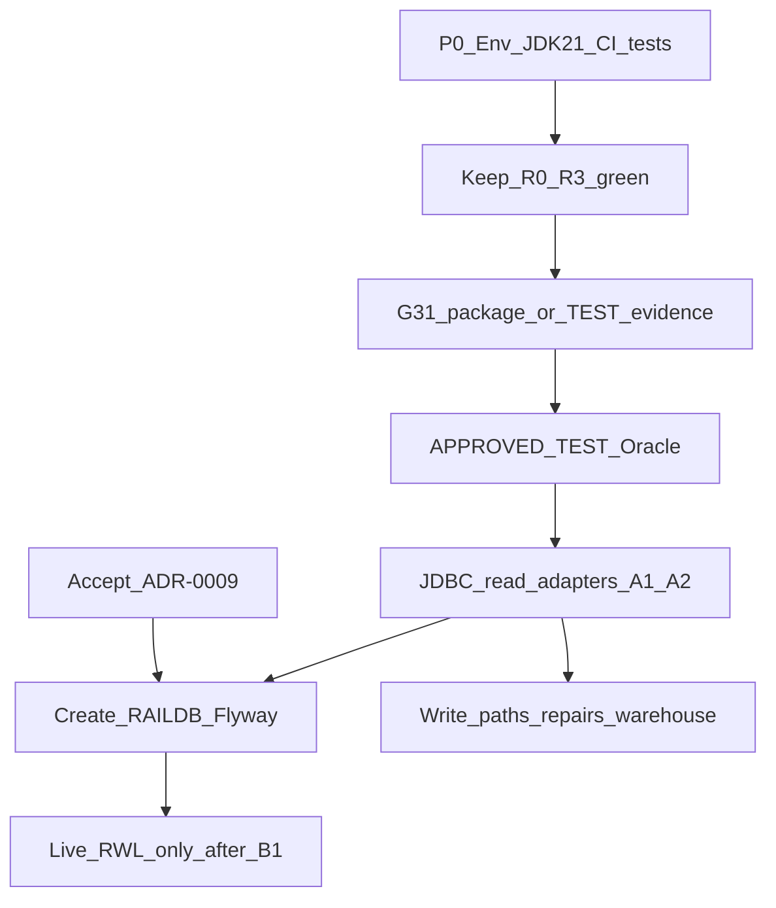

# ASUOP Development Plan — мультиагентная разработка

Дата снимка: 2026-11-20. Репозиторий: [jumabay/ASUOP-project](https://github.com/jumabay/ASUOP-project), рабочий каталог `АСУВП`. Ветка политики: `main`.

Этот документ — операционный план для главного агента и subagents. Он **не** заменяет ADR и `APPROVALS_TEMPLATE.md`.

## 1. Текущее состояние приложения

### Стек (утверждён)

| Слой | Факт |
| --- | --- |
| Backend | Java 21, Spring Boot 3.5.x, Spring Modulith 1.4.x, Gradle multi-project |
| Данные | Synthetic adapters по умолчанию; JDBC к Oracle 12.2 (`ojdbc10:19.33`) — smoke был разовый; постоянный доступ DENIED |
| Frontend | React + TypeScript + Vite, Ant Design, AG Grid Community |
| Интеграции | FTP/live import — вне кода хоста; RWL — offline fixtures (`platform-rwl`, `modules/intake`); 1С — DENIED |
| Целевой store | ADR-0009 **PROPOSED**: `RAILDB` / `RAIL_APP`; DBTC — миграция/архив |

### Структура репозитория

```text
platform-app/            Spring Boot host + REST
platform-oracle/         synthetic (+ raildb-test stubs, no connect)
platform-disl-parser/    R0 KZ parser + local hour journal
platform-rwl/            offline RWL parse/normalize pipeline
modules/fleet|dislocation|intake
frontend/                Vite UI
tools/                   jdbc-smoke, dictionary-inspector, rwl-import-proto (осторожно с секретами)
docs/architecture|analysis
.cursor/rules|skills|agents
```

### Журнал реализации (код)

| Этап | Статус | Содержание |
| --- | --- | --- |
| R0 | DONE | `platform-disl-parser`, JUnit, без JDBC |
| R1 | DONE (synthetic) | A2 карточка + A1 сутки среза, REST + React |
| R2 | DONE (synthetic) | Реестр вагонов, paging/search |
| R3 | DONE (synthetic) | «Вагоны на слежении», synthetic 60 кодов |
| R4 | DONE (research) | Evidence NUFF `GetActiveWagonList` — caller UI не найден (G31 OPEN) |
| P0–P3C | Docs / partial | RAILDB pack, offline RWL, dictionary probes; P3C-1 PARTIAL (NK1/DT1 BLOCKED, G31) |
| P4-0 | APPROVED / DONE (PR #6) | Storage contracts R1–R3: [40](../architecture/40_P4_0_RAILDB_STORAGE_CONTRACTS.md), [41](../architecture/41_P4_0_R1_R3_FIELD_MAPPING.md); V0b + `sql/raildb/read/*`. Create/Flyway/JDBC — нет |
| P4-1 | docs-only (this wave) | Scale ~18k + migration L0 verification model: [ASUOP_P4_1_SCALE_MIGRATION_PLAN.md](ASUOP_P4_1_SCALE_MIGRATION_PLAN.md), [44](../architecture/44_MIGRATION_VERIFICATION_MODEL_OFFLINE.md)–[47](../architecture/47_SCALE_MIGRATION_TEST_STRATEGY.md). CODE fixtures/UX — отдельный APPROVED |
| JDBC parity | Disabled | Нет APPROVED TEST Oracle URL |
| Live import / RAILDB create / Flyway apply | DENIED | Ждут отдельных строк APPROVALS |

## 2. Реально работающие модули (synthetic)

При поднятом `platform-app` (`synthetic`) и `frontend`:

| Возможность | API / UI | Доказательство в коде |
| --- | --- | --- |
| Карточка вагона | `GET /api/v1/wagons/{code}` + `WagonCardPanel` | R1 |
| История суток | day state report endpoints + `StateReportGrid` | R1 |
| Реестр | registry page DTO + `WagonRegistryGrid` | R2 |
| Слежение | `GET /api/v1/wagons/watched` + `WatchedWagonGrid` | R3 |
| Парсер KZ | библиотека + тесты R0 | без сети/БД |
| RWL offline | fixtures → normalize → intake batch | без live HTTP |
| Modulith / no DataSource | архитектурные тесты в `platform-app` | `ModulithArchitectureTest`, `NoOracleDataSourceTest` |

Ограничение: это **не** parity с legacy Oracle и **не** промышленный контур.

## 3. Недоработанные функции и долг

### Функциональные пробелы (продукт)

- A3–A8 и прочие экраны НУВ/УВП/НУД (ремонты, склад, отчёты, права) — вне synthetic R1–R3.
- JDBC adapters для fleet/dislocation — stubs / disabled IT.
- Live RWL, FTP intake cutover, single-writer enforcement в рантайме импорта.
- Создание `RAILDB` + Flyway `RAIL_APP` (Accept ADR-0009 direction — DONE; Create/Flyway — DENIED).
- Закрытие G1–G8, G31 и связанных package body (см. `08_GAPS_AND_UNCERTAINTIES.md`).
- Expedition / finance / 1С — DENIED UNTIL APPROVED (требования не заданы).

### Технический долг / среда (снимок 2026-11-20, уточн. P0-2)

- На машине разработки `java` в PATH = **25**; утверждён **21**. Агенты обязаны выставлять `JAVA_HOME` на JDK 21.
- `~/.gradle/gradle.properties` может держать `org.gradle.java.home` на JDK 17 (выше приоритета, чем project `gradle.properties`) — daemon тогда не на 21. Обход агентов: `scripts/gradle-jdk21.ps1` (изолированный ASCII `GRADLE_USER_HOME`).
- Полный `gradlew test` в каталоге с кириллическим путём даёт `ClassNotFoundException` на test-классах (подтверждено P0-2). Обход: `subst` / `scripts/gradle-jdk21.ps1`. Документация: `docs/agents/BUILD_JDK21_WINDOWS.md`. CI: `.github/workflows/gradle-jdk21-test.yml`.
- `JdbcParityIT` отключён до TEST Oracle.
- `tools/rwl-import-proto` — не коммитить целиком без secret-review.

## 4. Зависимости между задачами



Правило: **чтение на synthetic** можно расширять при APPROVED scope; **чтение Oracle**, **запись**, **RAILDB DDL**, **live integrations** — только после соответствующих строк APPROVALS.

## 5. Приоритеты

### P0 — сейчас (без Oracle)

| ID | Задача | Агенты | Критерий готовности |
| --- | --- | --- | --- |
| P0-1 | Зафиксировать мультиагентный контур (agents, AGENTS, rules, этот план) | lead | Файлы в PR; без бизнес-кода |
| P0-2 | Стабильный тест-прогон на JDK 21 (+ ASCII path / CI) | qa, backend | **DONE** (PR #2). `gradlew test` + frontend tests + CI Temurin 21 |
| P0-3 | Регрессионный чеклист R0–R3 REST/UI | qa, frontend | Чеклист + автоматические тесты не красные |
| P0-4 | Secret-hygiene review tools/docs before next code wave | qa, database | Нет секретов в Git; `.gitignore` актуален |
| P0-5 | Synthetic runtime smoke (boot + REST R1–R3 + FE/API + CI offline) | backend, frontend, qa | App поднимается на `synthetic`; smoke/e2e без Oracle; логи и QA-verdict; **APPROVED** в APPROVALS. Runbook: [SYNTHETIC_RUNTIME_SMOKE.md](SYNTHETIC_RUNTIME_SMOKE.md) |

### P1 — следующий продуктовый контур (нужны разрешения)

| ID | Задача | Блокер | Агенты |
| --- | --- | --- | --- |
| P1-1 | Выдать TEST Oracle + read-only учётка | APPROVALS | database, lead |
| P1-2 | Включить/написать JDBC read adapters для A1/A2 + parity IT | P1-1 | backend, database, qa |
| P1-3 | Закрыть G31 / критерий watched list vs legacy | package text или TEST | database, backend |
| P1-4 | Playwright browser e2e smoke (synthetic/offline) | **APPROVED WITH CONSTRAINTS** (см. APPROVALS); выполнять с P0-5 | frontend, qa |

### P2 — миграция и расширения

| ID | Задача | Блокер | Агенты |
| --- | --- | --- | --- |
| P2-1 | Accept ADR-0009 | **DONE (direction only)** 2026-11-20; [42](../architecture/42_ADR0009_DECISION_READINESS.md), [43](../architecture/43_ADR0009_DBA_CREATE_CHECKLIST.md) | lead, database |
| P4-0 | Storage contracts R1–R3 offline | **DONE** (PR #6); [40](../architecture/40_P4_0_RAILDB_STORAGE_CONTRACTS.md), [41](../architecture/41_P4_0_R1_R3_FIELD_MAPPING.md) | backend, database |
| P4-1 | Scale (~18k) + migration L0 verification offline | Plan [ASUOP_P4_1_SCALE_MIGRATION_PLAN.md](ASUOP_P4_1_SCALE_MIGRATION_PLAN.md); docs [44](../architecture/44_MIGRATION_VERIFICATION_MODEL_OFFLINE.md)–[47](../architecture/47_SCALE_MIGRATION_TEST_STRATEGY.md) | all |
| P2-2 | Create RAILDB + Flyway `RAIL_APP` | DBA checklist 43 + **отдельные** APPROVED Create, затем Flyway | database, backend |
| P2-3 | Offline→controlled RWL/FTP intake design + B-tests | P2-2 / B1 | backend, database, qa |
| P2-4 | Ремонты / склад read-only screens | research G6+ | backend, frontend |
| P2-5 | Expedition / finance / 1С | отдельные требования | all (после APPROVED) |

## 6. Распределение ролей

| Агент | Делает | Не делает |
| --- | --- | --- |
| Lead (этот чат / Manager) | Scope, APPROVALS, ветки, PR, эскалации | Тихий merge в `main`; обход запретов |
| `/backend` | Java API, порты, synthetic/JDBC adapters по разрешению | UI; DDL на prod |
| `/frontend` | React экраны и клиент API | Смена контрактов в одиночку; секреты |
| `/database` | SQL/схемы/миграция/perf evidence | Авто-apply миграций; удаление данных |
| `/qa` | Тесты, регрессии, security/safety verdict | «Починить» ослаблением assert без согласования |

Параллель: backend+frontend на разных путях OK; database offline docs параллельно OK; два агента на один модуль — только через worktree/очередь.

## 7. Критерии готовности задачи (Definition of Done)

1. Есть строка APPROVED (или задача явно docs/config-only в рамках этого плана).
2. Изменения только в согласованном scope; стек не менялся молча.
3. Feature-ветка + PR в `main`.
4. Тесты прогнаны (JDK 21); отчёт `/qa` = PASS или BLOCKED с причиной.
5. Нет секретов в диффе; Oracle/FTP/RWL live не затронуты без разрешения.
6. Обновлены затронутые docs/APPROVALS при смене статуса этапа.
7. Merge — только после человеческого одобрения.

## 8. План первого самостоятельного цикла разработки

Цель цикла: **закрыть P0-2 и P0-3**, не открывая Oracle.

1. Lead создаёт `feature/p0-build-test-stability` (отдельный PR от конфигурации агентов).
2. `/qa` воспроизводит `gradlew test` на JDK 21 через ASCII `subst` / `scripts/gradle-jdk21.ps1` (или чинит конфигурацию тестов, если дефект в build).
3. `/backend` устраняет только то, что ломает classpath/сборку (минимальный дифф) — docs/scripts/CI для JDK 21 + Windows path.
4. `/frontend` подтверждает `npm test` + `npm run build`.
5. `/qa` пишет короткий regression sheet R1–R3 (карточка, сутки, реестр, слежение).
6. PR → review человека → merge в `main`.
7. **DONE (PR #2).** Следующий цикл кода — только после строк APPROVALS на P0-5 / P1-4 (docs-only PR) и merge.

### Цикл P0-5 / P1-4 (после merge APPROVALS)

1. Lead: `feature/p0-synthetic-runtime-smoke`.
2. `/backend`: boot `synthetic` на JDK 21; REST smoke R1–R3; чинит только test/CI infra.
3. `/frontend`: UI↔API integration + Playwright smoke (synthetic/offline only).
4. GitHub Actions: offline job(s) без Oracle/FTP/RWL.
5. `/qa`: независимый verdict по логам; без ослабления assert.
6. PR → human merge. **Не** JDBC / RAILDB / live integrations.

## 9. Ссылки

- Approvals: [`../architecture/APPROVALS_TEMPLATE.md`](../architecture/APPROVALS_TEMPLATE.md)
- Stack: [`../architecture/02_TECHNOLOGY_STACK.md`](../architecture/02_TECHNOLOGY_STACK.md)
- Testing: [`../architecture/16_TESTING_STRATEGY.md`](../architecture/16_TESTING_STRATEGY.md)
- Gaps: [`../analysis/08_GAPS_AND_UNCERTAINTIES.md`](../analysis/08_GAPS_AND_UNCERTAINTIES.md)
- Agents: `/.cursor/agents/{backend,frontend,database,qa}.md`
