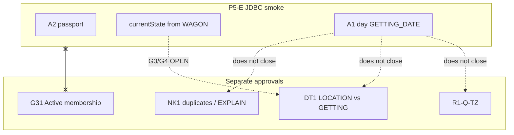

# ASUOP — план P5-E: JDBC read A1/A2 на TEST Oracle

Дата: **2026-11-24**.  
База: Wave 2A **DONE** на `main` @ `3f1739c` (+ completion report merge `e6d62e4`).  
Evidence Wave 2A: [P5_WAVE2A_COMPLETION_REPORT.md](P5_WAVE2A_COMPLETION_REPORT.md).

**Тип документа:** PLAN / RESEARCH (документация и анализ кода).  
**Не делает:** live Oracle/JDBC, снятие `@Disabled` с `JdbcParityIT`, Flyway/Create RAILDB, live FTP/RWL, writes, auto-merge.  
**Не меняет статусы:** `P5-E`, `P5-F`, `P5-H`, `R1 JDBC against TEST Oracle` остаются **DENIED UNTIL APPROVED** до отдельного решения владельца.  
Секреты, пароли, полные connect-string с credentials — **не** включать в документ и логи.

Журнал: [APPROVALS_TEMPLATE.md](../architecture/APPROVALS_TEMPLATE.md).  
Контракты A1/A2: [23_R1_A1_A2_IMPLEMENTATION_PLAN.md](../architecture/23_R1_A1_A2_IMPLEMENTATION_PLAN.md).  
Mapping REST→RAIL_*: [41_P4_0_R1_R3_FIELD_MAPPING.md](../architecture/41_P4_0_R1_R3_FIELD_MAPPING.md).

---

## 0. Цель и границы

### Цель

Подготовить **минимальный** scoped JDBC read-smoke для **A1 (сутки)** и **A2 (карточка + optional `currentState`)** на **dedicated TEST Oracle**, схема **`DBTC`**, read-only, с явной сверкой Oracle → API → UI — **без** претензии на закрытие G31/NK1/DT1/R1-Q-TZ.

### In scope (после будущей строки APPROVED на исполнение)

| ID | Операция | REST / экран |
| --- | --- | --- |
| **E-A2** | Чтение паспорта вагона | `GET /api/v1/wagons/{wagonCode}` → UI `WagonCardPanel` |
| **E-CUR** | Чтение `currentState` (отдельный источник) | тот же endpoint, блок «Текущее состояние» |
| **E-A1** | Чтение строк суток | `GET /api/v1/wagons/{wagonCode}/state-reports?date=` → UI `StateReportGrid` |
| **E-IT** | Включить и наполнить `JdbcParityIT` под gate TEST | только CI/local с env credentials |

### Out of scope для P5-E (отдельные gates)

| Тема | Почему вне |
| --- | --- |
| **R2 registry** JDBC / `GetWagonList` parity | Predicate search/LIKE **UNKNOWN**; P5-G synthetic ≠ Oracle claim |
| **R3 watched** / G31 | Membership **OPEN**; RAIL stub empty |
| **P5-G** Oracle filter parity | Запрещено контрактом [54](../architecture/54_P5_G_FILTER_CONTRACT.md) |
| **NK1 / DT1 deep probes** | BLOCKED; отдельные SQL + DBA plan ([49](../architecture/49_NK1_DT1_G31_OFFLINE_RESEARCH.md)) |
| **G31 package BODY / Active** | Отдельный DBA request ([38](../architecture/38_P3C0_DBA_PACKAGE_SOURCE_REQUEST.md)) |
| Create RAILDB / Flyway / migrator | DENIED |
| Production RAC как постоянный allow-list | DENIED (исторический smoke ≠ TEST) |
| P5-F / P5-H | DENIED |

### Текущее состояние кода (факт Wave 2A)

| Контур | Факт |
| --- | --- |
| Адаптеры runtime | Только `synthetic` (+ `raildb-test` fail-fast stubs). **Нет** `platform-oracle/.../jdbc/` |
| `JdbcParityIT` | `@Disabled`; бросает `UnsupportedOperationException` |
| DataSource | `DataSourceAutoConfiguration` исключён; default profile `synthetic` |
| A2 + `currentState` | Synthetic: `.card.json` + **отдельный** `.current.json`; тест current ≠ last day line |
| A1 | Half-open сутки; max 500 → 422; ось synthetic = `dislocationTime` |
| R2/R3 | Passport enrichment + filters synthetic; watched `FIXTURE` / `EMPTY_PENDING_G31` |

---

## 1. Исходные адаптеры и контракты

### 1.1 Порты (DIP)

| Port | Метод | Adapter сейчас |
| --- | --- | --- |
| `WagonCardPort` | `findByCode` | `SyntheticWagonCardAdapter` / `RailDbWagonPortAdapterStub` |
| `StateReportDayPort` | `findLinesForDay` | `SyntheticStateReportDayAdapter` / stub |
| `WagonRegistryPort` | `findPage` | synthetic / stub — **вне первого JDBC slice** |
| `WatchedWagonPort` | `findPage` | FIXTURE / empty G31 — **вне P5-E** |

### 1.2 REST (не ломать без отдельной строки)

| Метод | Путь | DTO |
| --- | --- | --- |
| GET | `/api/v1/wagons/{wagonCode}` | `WagonCardDto` (+ optional `currentState`) |
| GET | `/api/v1/wagons/{wagonCode}/state-reports?date=YYYY-MM-DD` | `StateReportDayDto` |
| GET | `/api/v1/wagons` | registry — **не** обязателен в P5-E smoke |
| GET | `/api/v1/wagons/watched` | watched — **запрещён** как truth до G31 |

### 1.3 Legacy entrypoints (имена CONFIRMED, тела UNKNOWN)

| Операция | Пакет / член | Evidence |
| --- | --- | --- |
| A2 | `WagonPackage.GetWagonByCode` | [08_NUFF](../architecture/08_NUFF_ARCHITECTURE.md), [08_CROSS](../analysis/08_CROSS_SYSTEM_MATRIX.md) |
| A1 | `StateReportPackage.GetWagonStateReports` | тот же; клиент: 00:00:00–23:59:59 wall-clock |
| Реестр (вне E) | `WagonPackage.GetWagonList` | ≠ Active |
| Слежение (вне E) | `GetActiveWagonList` | G31 OPEN; UI call-site в НУВ не найден |

**Предпочтительный путь parity:** `EXECUTE` только на два read-члена пакетов (если DBA даст).  
**Fallback:** bind `SELECT` по таблицам ниже — с пометкой **PROVISIONAL**, пока SPEC/BODY не подтвердит курсор.

---

## 2. Перечень операций P5-E (что читает реальные данные)

| # | Операция | SQL / call | UI | Success criteria (smoke) |
| --- | ---: | --- | --- | --- |
| 1 | Resolve wagon | `WAGON.CODE = :code` → `ID` | — | 404 если нет |
| 2 | A2 passport | `GetWagonByCode` **или** SELECT `WAGON` + refs | Карточка passport | Поля §3 совпадают с эталоном Oracle (где mapping CONFIRMED) |
| 3 | E-CUR current | SELECT колонок current на `WAGON` (+ joins) — **не** day query | Блок «Текущее состояние» | Не равен last line выбранных суток (§4) |
| 4 | A1 day | `GetWagonStateReports` **или** SELECT tape | Таблица суток | Число строк и ключи; empty `[]` OK; >500 → 422 |
| 5 | Parity IT | `JdbcParityIT` на CONTROL-* | — | PASS smoke; label ≠ «NK1/DT1 CLOSED» |

Порядок остановки проверки — §5.4.

---

## 3. Поле → источник (DBTC / intended RAIL_*)

Условные обозначения: **CONFIRMED** (словарь/анализ), **INTENDED** (draft RAIL_*), **PROVISIONAL** (разумный join, нужна живая проверка), **UNKNOWN** (не подтверждено).

### 3.1 A2 — паспорт (`WagonCard` / registry passport)

| DTO field | DBTC source (P5-E) | Confidence | Intended RAIL_* ([41](../architecture/41_P4_0_R1_R3_FIELD_MAPPING.md)) |
| --- | --- | --- | --- |
| `wagonCode` | `WAGON.CODE` (UK) | **CONFIRMED** P3B | `rail_wagon.wagon_code` **INTENDED** |
| `model` | Вероятно `WAGON` FK → `WAGONMODELS` (имя колонки FK **UNKNOWN**) | **UNKNOWN** | `rail_wagon.model_code` **INTENDED** |
| `wagonKind` | Вероятно `WAGONTYPES` | **UNKNOWN** | `rail_wagon.wagon_kind` **INTENDED** |
| `ownerName` | Вероятно `WAGONOWNERS` / customer/owner refs | **UNKNOWN** | `rail_wagon.owner_name` **INTENDED** |
| `homeStationCode` | Home FK → `STATIONS.CODE` (какая колонка FK на `WAGON` — **UNKNOWN**) | **UNKNOWN** | `rail_station.station_code` via `home_station_id` **INTENDED** |
| `homeStationName` | `STATIONS.NAME` (или аналог) | **PROVISIONAL** (таблица CONFIRMED) | `rail_station.station_name` **PROVISIONAL** |
| `inventoryPark` | Флаг/колонка на `WAGON` — **UNKNOWN** имя | **UNKNOWN** | `rail_wagon.inventory_park` **INTENDED** |

**Объекты CONFIRMED существуют:** `WAGON`, `STATIONS`, `WAGONTYPES`, `WAGONMODELS`, `WAGONOWNERS` ([02_ORACLE_TABLES](../analysis/02_ORACLE_TABLES.md), [28](../architecture/28_DBTC_OBJECT_CATALOG.md)).  
Точный per-field column map — **после** первого scoped SPEC/`ALL_ARGUMENTS` курсора или DBA export; до этого в отчёте parity помечать поля как **UNKNOWN match skipped**, не как FAIL.

### 3.2 A1 — строка суток (`StateReportLine`)

| DTO field | DBTC source | Confidence | Notes |
| --- | --- | --- | --- |
| `reportId` | `STATEREPORTRECORDS.REPORT_ID` → header `STATEREPORTS.UK_REPORT_ID` | **PROVISIONAL** | Нет PK на tape |
| `wagonCode` | `WAGON.CODE` via `WAGON_ID` | **INTENDED** | |
| `dislocationTime` | **`GETTING_DATE`** (ось суток до закрытия DT1) | **CONFIRMED** для filter policy; **OPEN** vs «факт» `LOCATION_DATE` | Не фильтровать по `LOCATION_DATE` |
| `stationCode` | Station FK (`LOCATION_*` / др.) → `STATIONS.CODE` | **UNKNOWN** какая роль станции = UI | Несколько station FK на строке |
| `operationCode` | `OPERATION_ID` → `OPERATIONS` (код) | **UNKNOWN** строка vs id в курсоре | |

**Tape CONFIRMED:** `STATEREPORTRECORDS` (~1.2×10⁹), NOT NULL `WAGON_ID`,`REPORT_ID`,`CURRENT_STATE_ID`; index `IDX_REC_WAGON_ID (WAGON_ID, GETTING_DATE)`; обе даты `GETTING_DATE` и `LOCATION_DATE` ([36](../architecture/36_P3B_PARTIAL_DICTIONARY_FINDINGS.md)).

**Правила запроса суток (платформа):**

```text
beginInclusive = D 00:00:00
endExclusive   = (D + 1) 00:00:00
GETTING_DATE >= :day_from AND GETTING_DATE < :day_to
FETCH FIRST 501 ROWS ONLY   -- detect >500 → HTTP 422
ORDER BY GETTING_DATE ASC, (stable key PROVISIONAL)
NK1: retain all rows — no DISTINCT / UK collapse
```

Legacy клиент использует closed `00:00:00–23:59:59` — возможны расхождения на границе секунды; зафиксировать как **R1-Q-TZ / interval OPEN**, не «баг smoke».

### 3.3 Registry / watched (явно **не** в первом JDBC slice)

| API | DBTC | Статус |
| --- | --- | --- |
| `GET /wagons` item passport | позже `GetWagonList` / `WAGON` page | Predicate **UNKNOWN**; вне P5-E acceptance |
| `GET /wagons/watched` | G31 | **BLOCKED** до predicate; UI остаётся FIXTURE / empty |

---

## 4. `currentState` — источник и правила выбора

### 4.1 Продуктовое правило (R1 + P5-C) — обязательно сохранить на JDBC

1. **`currentState` ≠ последняя строка выбранных суток.**  
   Нельзя вычислять current как `MAX(day lines)` / last row A1.
2. Паспорт A2 **исторически** не требовал current; после P5-C current — **optional additive block** на карточке.
3. Сутки сохраняют свою семантику и date param; пустой день **не** очищает current.
4. Unknown / null → UI «—».

### 4.2 Synthetic (Wave 2A) — эталон поведения

| Артефакт | Путь |
| --- | --- |
| Passport | `synthetic/wagons/{code}.card.json` |
| Current | `synthetic/wagons/{code}.current.json` (**отдельный файл**) |
| Day | `synthetic/state-reports/{code}.{YYYYMMDD}.json` |
| Proof | `SYN-00001`: current `7100/05/2024-01-16T06:00:00/TRN-DIFF` ≠ day-2024-01-15 last `6902/01/…23:59:59.5` |

Код: `SyntheticWagonCardAdapter.loadCurrent` — **не** вызывает day adapter.

### 4.3 DBTC (P5-E) — provisional source

| DTO `currentState.*` | DBTC candidate | Confidence |
| --- | --- | --- |
| `stationCode` | `WAGON.LOCATIONSTATION_ID` → `STATIONS.CODE` | **PROVISIONAL** (колонка location CONFIRMED exist; display join PROVISIONAL) |
| `operationCode` | `WAGON.OPERATION_ID` → `OPERATIONS` | **UNKNOWN** code string |
| `dislocationTime` | `WAGON.LOCATIONDATE` **или** `WAGON.REPORTDATE` | **UNKNOWN** какая дата = UI time (**G3/G4 OPEN**: кто пишет `WAGON.LOCATION*` из tape не доказан) |
| `trainIndex` | колонка train на `WAGON` / related — **UNKNOWN** имя | **UNKNOWN** |

**Запрещено для выбора current:**

- `ORDER BY GETTING_DATE DESC FETCH FIRST 1` по `STATEREPORTRECORDS` за выбранный `date`
- Любой derive из response A1 того же запроса суток

**Целевой store (после Create RAILDB, не P5-E):** `rail_wagon_current` ([41](../architecture/41_P4_0_R1_R3_FIELD_MAPPING.md), `sql/raildb/read/wagon_card_by_code.sql`).

### 4.4 Acceptance для E-CUR

| Check | Pass |
| --- | --- |
| CONTROL-1 card current loaded from wagon master path | yes / null documented |
| Same wagon + day D: last A1 line vs current | **must differ** when both non-null **or** document why equal on that wagon (rare) with evidence |
| Empty day D_empty | current unchanged |

---

## 5. Минимальный запрос на разрешение TEST Oracle

> Черновик для владельца/DBA. **Не** является APPROVED. Секреты — только в secret store / env, не в git.

### 5.1 Цель разрешения

Одна scoped строка журнала (см. §9): **read-only JDBC A1/A2(+current) smoke** на **dedicated TEST** `DBTC`.  
Параллельно: **не** открывает Production allow-list, Create RAILDB, NK1/DT1/G31 research, watched truth.

### 5.2 Target

| Item | Request |
| --- | --- |
| Instance | Dedicated **TEST** service/PDB (имя — TBD DBA). **Не** подразумевать `tc-asuvp-03` / prod RAC |
| Schema | **`DBTC`** |
| App profile (future) | отдельный, напр. `oracle-test` — **не** смешивать с `synthetic` / `raildb-test` |
| RAILDB | **вне** этого разрешения |

### 5.3 Учётка

| Need | Detail |
| --- | --- |
| Privilege | `CREATE SESSION` + **SELECT** на объекты §5.3.1 |
| Prefer | `EXECUTE` **только** `WagonPackage.GetWagonByCode`, `StateReportPackage.GetWagonStateReports` |
| Deny | DDL/DML; `EXECUTE` writers (`ImportPkg.Save*`, `SaveWagon`, jobs); package BODY export (отдельный gate) |
| Creds | env / secret store; redacted URL в evidence |

#### 5.3.1 SELECT allow-list (минимум)

| Object | Зачем |
| --- | --- |
| `WAGON` | A2 + resolve CODE→ID + current candidates |
| `STATEREPORTRECORDS` | A1 lines (wagon-scoped + date bind) |
| `STATEREPORTS` | optional report header |
| `STATIONS` | codes/names |
| `OPERATIONS` | operation codes |
| `WAGONTYPES`, `WAGONMODELS`, `WAGONOWNERS` | passport joins **если** mapping подтверждён SPEC |

**Исключить из гранта P5-E:** unbounded analytics; `WAGONSTATEREPORTS*`; warehouse/repairs bulk; archives; TMP writers; NK1/DT1/G31 probe scripts.

### 5.4 Объём, таймауты, STOP

| Rule | Value |
| --- | --- |
| Card | `CODE = :wagon_code` `FETCH FIRST 1 ROW ONLY` |
| Day | bind `WAGON_ID` + half-open `GETTING_DATE`; `FETCH FIRST 501` |
| Statement timeout | **30 s** (как P3C tool); abort |
| Plan gate | DBA pre-check: **no** `TABLE ACCESS FULL` on `STATEREPORTRECORDS` for day pattern ([00_explain_plan_gates](../architecture/sql/dba/p4-2/00_explain_plan_gates.sql)) |
| **STOP** | FULL SCAN / cross-wagon / timeout / unexpected DML attempt → cancel session, fail IT, **do not retry** with wider window |
| Row examine cap | согласовать с DBA (рекомендация: ≤ 5 000 examined per statement for smoke) |
| Sessions | один разработчик / CI job; без параллельных heavy probes |

### 5.5 Порядок проверки (stop order)

1. G0: `SELECT 1 FROM DUAL` / session user / `CURRENT_SCHEMA`  
2. Resolve CONTROL-1 `WAGON.CODE`  
3. A2 passport (+ optional current)  
4. A1 empty day  
5. A1 non-empty day (≤500)  
6. A1 overflow day **или** synthetic-only 422 path if TEST не даёт >500  
7. UI spot-check CONTROL-1  
8. **STOP** — не запускать NK1/DT1/G31 SQL в том же окне

---

## 6. Разделение P5-E и исследований G31 / NK1 / DT1



| Gap | Status | Blocks P5-E smoke? | Blocks which function |
| --- | --- | --- | --- |
| **NK1** | BLOCKED | **No** (retain-all policy) | Claim «exact natural key / dedup ≡ legacy»; migration UK |
| **DT1** | BLOCKED | **No** if axis fixed to `GETTING_DATE` | Claim «dislocationTime ≡ LOCATION_DATE / user fact»; switching day axis |
| **R1-Q-TZ** | OPEN | **No** for smoke | Exact boundary vs legacy 23:59:59; TZ label |
| **G31** | OPEN | **No** for A1/A2 | **R3 watched truth**, M8 migrate watched, Active parity |
| **G3/G4** (`WAGON.LOCATION*` writer) | OPEN | Soft for E-CUR | High-confidence current vs tape equality claims |
| **Passport column map** | UNKNOWN | Soft | Strict field-by-field A2 FAIL without SPEC |
| **APPROVALS TEST JDBC** | DENIED | **Yes** — hard gate | Весь P5-E CODE / IT enable |

P5-E evidence label: **`SMOKE_PASS` / `SMOKE_FAIL` / `SKIPPED_UNKNOWN_MAPPING`**.  
Запрещено писать в отчёте: «NK1 CLOSED», «DT1 CLOSED», «G31 CLOSED».

---

## 7. Контрольные вагоны и сверка Oracle → API → UI

Реальные `CODE` выбирает владелец/DBA на TEST; ниже — **правила слотов**, не выдуманные номера.

| Slot | Selection rule | Exercises |
| --- | --- | --- |
| **CONTROL-1** | Есть в `WAGON`; день **D** даёт 1–20 строк по `IDX_REC_WAGON_ID` + half-open `GETTING_DATE` | Happy A2+A1+UI |
| **CONTROL-2** | Тот же или второй код; день **D∅** с 0 строк | `lines: []` |
| **CONTROL-3** | День с **>500** строк **или** IT-only synthetic overflow | HTTP **422** |
| **CONTROL-4** | (optional) известные дубликаты tape same day | Retain-all; слот может быть vacant до NK1 |
| **CONTROL-5** | (optional) `|GETTING−LOCATION| > 1h` | Disclosure DT1 only — не закрывает DT1 |

**Исключить из CONTROL:** `SYN-*`; коды из fixture watched 60; коды из `wagons.txt` / Active без G31.

### 7.1 Протокол сверки

| Step | Oracle | API | UI |
| --- | --- | --- | --- |
| 1 | Package call **или** approved SELECT for CONTROL-1 | `GET /api/v1/wagons/{code}` | `WagonCardPanel` passport + current |
| 2 | Day cursor / SELECT for date D | `GET .../state-reports?date=D` | `StateReportGrid` row count + keys |
| 3 | Compare | A2 CONFIRMED fields; A1 `reportId/wagonCode/time/station/operation` where mapped | Visual match; «—» for null |
| 4 | Anti-rule | — | **Assert** current block ≠ last grid row when both present (or document) |
| 5 | Empty day | — | Day empty; current still shown |

Артефакты evidence (без секретов): redacted service name, grant list, row counts, optional EXPLAIN screenshot out-of-git if sensitive.

---

## 8. План исполнения CODE (только после APPROVED)

Не часть этого docs PR.

1. Feature-ветка `feature/p5-e-jdbc-a1-a2` от `main`.  
2. Profile `oracle-test` + env DataSource; ojdbc10+orai18n per APPROVED driver row.  
3. JDBC adapters implementing `WagonCardPort` + `StateReportDayPort` only.  
4. Enable `JdbcParityIT` under profile/gate; keep default `synthetic` green.  
5. `/qa` + `/qa-test-runner`: synthetic regression **must** stay green; Oracle IT opt-in.  
6. PR → human merge; **no** auto-merge; **no** Production URL.

---

## 9. Проект строк APPROVALS

### 9.1 Этот PR (docs-only) — к добавлению как APPROVED

См. фактическую строку в [APPROVALS_TEMPLATE.md](../architecture/APPROVALS_TEMPLATE.md):  
**«P5-E planning after Wave 2A (docs-only)»**.

### 9.2 Проект будущей строки исполнения (остаётся DENIED до решения владельца)

```text
| P5-E JDBC read A1/A2 on TEST Oracle | APPROVED WITH CONSTRAINTS | Owner: dedicated TEST DBTC read-only;
  WagonPackage.GetWagonByCode + StateReportPackage.GetWagonStateReports and/or SELECT allow-list
  (WAGON, STATEREPORTRECORDS, STATEREPORTS, STATIONS, OPERATIONS, passport refs);
  currentState from WAGON master path — NOT last day line; day axis GETTING_DATE half-open;
  FETCH 501 / 30s timeout / STOP on FULL SCAN; enable JdbcParityIT under oracle-test only;
  CONTROL-1..3 Oracle→API→UI smoke. Does NOT close G31/NK1/DT1/R1-Q-TZ; no watched JDBC truth;
  no registry LIKE parity; no Production allow-list; no Create RAILDB/Flyway/writes/FTP/RWL;
  no auto-merge. Plan: ASUOP_P5_E_JDBC_READ_PLAN.md. Requires companion row or same text for
  «R1 JDBC against TEST Oracle» with TEST service name (no secrets in git). | <date> |
```

До утверждения владельцем строки **P5-E** и **R1 JDBC against TEST Oracle** в журнале остаются **DENIED UNTIL APPROVED**.

### 9.3 Отдельные будущие строки (не смешивать с P5-E)

| Decision (draft title) | Purpose |
| --- | --- |
| NK1 tape probes on TEST | duplicate rates + EXPLAIN |
| DT1 date-axis probes on TEST | GETTING vs LOCATION evidence |
| G31 package source / Active predicate | watched truth |
| Create RAILDB TEST | instance + Flyway later |

---

## 10. Риски и residual

| Risk | Mitigation |
| --- | --- |
| Package SQL ≠ table rewrite | Prefer EXECUTE packages; mark table path PROVISIONAL |
| Half-open vs legacy closed day | Document boundary deltas; don’t “fix” TZ |
| Passport UNKNOWN columns | SKIPPED_UNKNOWN_MAPPING; request SPEC |
| Accidental prod connect | Explicit TEST service in APPROVALS; deny prod host |
| Scope creep into G31/registry | Hard out-of-scope list §0 |
| current from tape | Banned in §4; test anti-rule |

---

## 11. Ссылки

- Approvals: [APPROVALS_TEMPLATE.md](../architecture/APPROVALS_TEMPLATE.md)
- Wave 2A: [P5_WAVE2A_COMPLETION_REPORT.md](P5_WAVE2A_COMPLETION_REPORT.md)
- P5 plan: [ASUOP_P5_NUFF_FUNCTIONAL_PLAN.md](ASUOP_P5_NUFF_FUNCTIONAL_PLAN.md)
- Test matrix: [53_P5_NUFF_TEST_MATRIX.md](../architecture/53_P5_NUFF_TEST_MATRIX.md)
- Gaps: [08_GAPS_AND_UNCERTAINTIES.md](../analysis/08_GAPS_AND_UNCERTAINTIES.md), [49](../architecture/49_NK1_DT1_G31_OFFLINE_RESEARCH.md)
- DBA package request: [38](../architecture/38_P3C0_DBA_PACKAGE_SOURCE_REQUEST.md)
- SQL stubs RAILDB (future, not P5-E target): [sql/raildb/read/](../architecture/sql/raildb/read/)
