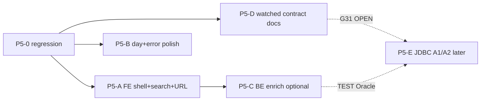

# ASUOP — план этапа P5: функциональное развитие НУФФ (номерной учёт)

Дата: **2026-11-20**. База: `main` @ `21c718e` (после P4-2; Independent QA PASS; GitHub Actions SUCCESS).  
Репозиторий: [jumabay/ASUOP-project](https://github.com/jumabay/ASUOP-project).  
**Docs-only.** Не заменяет [APPROVALS_TEMPLATE.md](../architecture/APPROVALS_TEMPLATE.md) и ADR.  
Код функциональности, Oracle connect, Flyway apply, Create RAILDB, live FTP/RWL — **вне этого PR**.

**Метод:** аудиты `/backend`, `/frontend`, `/database`, `/qa` (PLAN/RESEARCH); факты из кода R1–R3 и docs; неизвестные legacy-правила = **OPEN**.

---

## 0. Цель P5

Развить модуль **номерного учёта вагонов (НУФФ / НУВ-контур)** на уже утверждённом стеке Java + React, опираясь на **synthetic/offline** данные, так чтобы 20–30 операторов могли устойчиво работать с реестром **18 000–30 000** вагонов **без** претензии на legacy parity и **без** открытия Create/Flyway/JDBC, пока владелец не утвердит отдельные строки.

Параллельный track (Create RAILDB TEST, NK1/DT1/G31 probes) **не смешивается** с функциональными срезами P5: P5 не закрывает NK1/DT1/G31.

---

## 1. Исходное состояние (после P4-2)

| Контур | Статус |
| --- | --- |
| R1 card + day (synthetic) | DONE |
| R2 registry paging/search (synthetic) | DONE |
| R3 watched list fixture 60 (synthetic) | DONE; **≠** `GetActiveWagonList` (G31 OPEN) |
| P4-0 storage contracts | DONE (docs + stubs) |
| P4-1 scale UX / fixtures / L0 | APPROVED (частично в коде UX; scale tag opt-in) |
| P4-2 DBA readiness + offline NK1/DT1/G31 | DONE (docs); Create/JDBC — DENIED |
| ADR-0009 | Direction accepted; Create/Flyway/JDBC/migrate — DENIED |
| JDBC parity | `@Disabled` |

Единственный REST: `WagonController` — только **GET**. Default profile: `synthetic`.

---

## 2. Сводка аудитов (агенты)

### 2.1 Backend — DONE / PARTIAL / ABSENT

| Возможность | Статус | Факт |
| --- | --- | --- |
| Реестр | PARTIAL | `GET /api/v1/wagons`; item = `wagonCode` only; search = contains; page ≤200 |
| Карточка | PARTIAL | Passport A2; нет current dislocation; нет `SaveWagon` |
| История суток | PARTIAL | Day lines + 500→422; ось GETTING; DT1/R1-Q-TZ/NK1 OPEN |
| Поиск/фильтры | PARTIAL | Code contains + sort code; нет multi-field |
| Слежение | PARTIAL | Read-only fixture; membership ≠ legacy |
| Массовые операции | ABSENT | Нет write/bulk API |
| Конкурентные изменения | ABSENT | Нет ETag/409/version (всё GET) |
| Ошибки | PARTIAL | 400/404/422 стабильны; нет Oracle/conflict taxonomy |

Рекомендованные BE-срезы: enrichment реестра, current-state block, day field pack, filter criteria port, watched source enum, error contract hardening; JDBC/write — позже и отдельно.

### 2.2 Frontend — экраны и UX

| Экран | Маршрут | Статус |
| --- | --- | --- |
| Watched / Registry / Card / Day | один SPA; query `tab`/`wagon`/`date` | DONE (R1–R3 + P4-1 UX: debounce, showTotal, deep-link, card≠day) |
| App shell (Sider, global search) | — | ABSENT |
| Persist list search/page/sort в URL | — | PARTIAL (только tab/wagon/date) |
| Prefs localStorage | — | ABSENT; политика **OPEN** |
| Day client sort / row count caption | — | ABSENT |
| Multi-card tabs / Excel / auth UI | — | ABSENT / OPEN |
| Repairs / warehouse | stubs disabled | DENIED до отдельного APPROVED |

Масштаб: серверная страница ≤200; никогда не грузить весь каталог; AG Grid Community без Enterprise/SSRM.

### 2.3 Database — сущности (ADR-0009 / P4-0)

| Сущность | Статус | Synthetic сейчас | RAILDB позже |
| --- | --- | --- | --- |
| Wagon passport | CONFIRMED | R1/R2 | `rail_wagon` |
| Station | CONFIRMED / PARTIAL display | Yes | `rail_station` |
| Disl day event | PARTIAL (NK1) | R1 day | `rail_disl_event` |
| Wagon current | PARTIAL | optional | `rail_wagon_current` |
| Watched membership | OPEN (G31) | fixture 60; RAIL **empty** | `rail_wagon_watched` empty until G31 |
| Import kit / refs | PARTIAL | fixtures | kits + REF |

**Writes** (SaveWagon, planner, FTP publish, migrate M8) — **DENIED** until separate APPROVALS. Functional P5 на synthetic **не блокируется** Create RAILDB.

### 2.4 QA — что тестируемо

| Класс сценариев | Synthetic | Oracle/TEST |
| --- | --- | --- |
| R1–R3 REST/UI/e2e, 404/422, paging, debounce | Да (уже плотно) | Нет для regression |
| A1/A2 legacy parity | Нет | Да + APPROVED TEST |
| G31 watched truth / M8 | Нет (fixture ≠ Active) | Да + G31 pick |
| Scale p95 contractual | Soft only | Да (измерение) |
| Bulk / concurrency | N/A / нет suite | Да, если появятся writes |

Матрица: [53_P5_NUFF_TEST_MATRIX.md](../architecture/53_P5_NUFF_TEST_MATRIX.md).

---

## 3. Границы P5

### In scope (после строк APPROVALS на срезы)

- Улучшение **read-only** NUFF UX/API на `synthetic` (и контракт-совместимые расширения DTO только с отдельной строкой).
- App shell stubs, global search, list URL state, day polish, error retry.
- Docs: entity/ops matrix, watched product rule (empty until G31), day-axis disclosure.
- Регрессия R0–R3 + Playwright/Vitest/Gradle offline.

### Out of scope (отдельные gates)

- Create RAILDB / Flyway apply / JDBC live / снятие `@Disabled` с `JdbcParityIT`.
- Закрытие NK1 / DT1 / G31 без DBA evidence.
- `SaveWagon`, bulk mutate, FTP publish, live RWL, planner G10 writes.
- A3–A8 repairs/warehouse screens (кроме disabled stubs).
- Expedition / finance / 1С.
- Enterprise AG Grid / SSRM.
- Auto-merge.

---

## 4. Независимые срезы P5

Каждый срез = отдельная (или сгруппированная) строка APPROVALS + feature-ветка + PR. Порядок — рекомендуемый; **P5-0** всегда green.

| ID | Название | Агенты | Зависимости | Критерии приёмки (sketch) |
| --- | --- | --- | --- | --- |
| **P5-0** | Keep R0–R3 green | qa-test-runner, lead | none | JDK21 Gradle + FE Vitest/build + Playwright T0; no secrets; no `@Disabled` removal |
| **P5-A** | FE shell + global search + list URL | `/frontend`, `/qa` | P5-0; R1–R3 unchanged | Sider stubs; header search → card only; F5 restores `search/page/size/sort`; size≤200; Vitest+Playwright |
| **P5-B** | Day polish + list retry | `/frontend`, `/qa` | P5-0 | Caption N/max500; optional client sort on loaded day; Alert «Повторить»; empty/422 preserved |
| **P5-C** | BE registry enrichment + optional current block | `/backend`, `/frontend`, `/qa` | Owner OK on additive DTO; FE agreement | Additive fields documented; MockMvc+contract tests; no Oracle; no breaking page contract without version note |
| **P5-D** | Watched membership contract (docs+synthetic enum) | `/backend`, `/database`, `/qa` | none for docs | API/docs: source=`FIXTURE`; RAIL empty until G31; tests assert ≠ Active; L0 watched empty unchanged |
| **P5-E** | JDBC read A1/A2 on TEST | `/backend`, `/database`, `/qa` | **APPROVED TEST Oracle** (+ ideally DT1/NK1 evidence) | Parity IT enabled under gate; RO bind SQL; no write; no prod |
| **P5-F** | Prefs localStorage / multi-card tabs | `/frontend` | **OPEN** owner policy | Only after explicit APPROVED; no PII/secrets in storage |
| **P5-G** | Filter criteria port (multi-field) | `/backend`, `/frontend` | Semantics OPEN until product | Synthetic criteria; 400 invalid; no claim Oracle LIKE parity |
| **P5-H** | Card write / bulk / concurrency | — | DENIED | Не планировать в первой волне P5 |

### OPEN (не закрывать в коде как CONFIRMED)

| ID | Вопрос |
| --- | --- |
| G31 | Источник «слежения» vs Active / wagons.txt / GetWagonList |
| NK1 | Natural key / duplicates на ленте |
| DT1 | GETTING vs LOCATION axis |
| R1-Q-TZ | TZ границы суток |
| Prefs | URL vs localStorage policy |
| Registry search | Legacy predicate TBD |
| Bulk/concurrency rules | Нет CONFIRMED NUFF mass-edit rules |
| Card station vs last day line | Не равны (явное R1 правило) |

---

## 5. Распределение работы

| Фаза | Lead | Backend | Frontend | Database | QA / QA Test Runner |
| --- | --- | --- | --- | --- | --- |
| Этот PR (plan) | Сборка плана + APPROVALS draft + PR | audit input | audit input | audit input | test matrix input |
| P5-0 | PR gate | — | — | — | Independent PASS evidence |
| P5-A / P5-B | Scope/PR | API smoke only if needed | CODE UI | — | Vitest/Playwright + safety |
| P5-C / P5-G | DTO approval | Ports/DTO/adapters synthetic | Grid columns | Mapping note vs [41] | MockMvc + FE contract |
| P5-D | Product wording | Enum/docs | Label honesty | Empty watched rule | Assert empty migrate |
| P5-E | APPROVALS TEST | JDBC adapters | — | SQL bind + probes | Parity IT evidence |
| Parallel Create RAILDB | Owner+DBA | — | — | [43]/[48]/[50] | Docs review only |

Параллель: P5-A и P5-B / P5-D на разных путях OK. Не два писателя на одни файлы без worktree.

---

## 6. Риски

| Риск | Митигация |
| --- | --- |
| Synthetic green ≠ legacy parity | Явные метки «regression only»; parity только P5-E |
| Watched Tag / fixture воспринимается как Active | P5-D wording; G31 OPEN banner in docs |
| DTO enrichment ломает FE | Additive + contract tests; отдельная APPROVALS |
| Page size >200 / full catalog в браузере | Hard max 200; no client Quick Filter as full park |
| Смешение P5 с Create RAILDB | Stop line: Create только после DBA+APPROVED |
| Ложное закрытие NK1/DT1/G31 | Запрет в APPROVALS; retain-all / empty watched |
| ADR journal drift | APPROVALS wins over ADR file wording for execution |

---

## 7. Критерии готовности этапа P5 (волна 1)

1. Owner утвердил строки APPROVALS на выбранные срезы (минимум P5-A…P5-D или подмножество).
2. Каждый срез: feature-ветка → PR → Independent QA PASS (или CI-labeled) → human merge.
3. R1–R3 regression green; secrets отсутствуют.
4. NK1/DT1/G31 **не** помечены CONFIRMED без evidence.
5. Нет Create/Flyway/JDBC/live integrations без своих строк.

---

## 8. Stop line / Wave 1 gate

**Planning (PR #20):** MERGED. **APPROVALS wave 1 (PR #21):** MERGED.

**Wave 1 CODE — DONE (2026-11-24):** P5-A/B/D merged to `main` @ **`68564a5`**.  
Evidence: [P5_WAVE1_COMPLETION_REPORT.md](P5_WAVE1_COMPLETION_REPORT.md) (Gradle smoke+watched, Vitest 37, Playwright T0+A/B/D 18/18).

**Wave 2 proposal (docs):** [ASUOP_P5_WAVE2_PROPOSAL.md](ASUOP_P5_WAVE2_PROPOSAL.md) — recommend synthetic **P5-C + P5-G**; optional F; E after TEST JDBC; H out.  
**По-прежнему DENIED until APPROVED:** P5-C/E/F/G/H CODE; Create RAILDB TEST; Oracle JDBC/Flyway/live migrate; FTP/RWL live; writes/bulk; auto-merge.  
NK1/DT1 **BLOCKED**; G31 **OPEN**; RAIL watched **empty** until G31.

---

## 9. Ссылки

- Approvals: [APPROVALS_TEMPLATE.md](../architecture/APPROVALS_TEMPLATE.md)
- NUFF: [08_NUFF_ARCHITECTURE.md](../architecture/08_NUFF_ARCHITECTURE.md)
- Active list evidence: [11-nuff-active-wagon-list.md](../analysis/11-nuff-active-wagon-list.md)
- Storage: [40](../architecture/40_P4_0_RAILDB_STORAGE_CONTRACTS.md), [41](../architecture/41_P4_0_R1_R3_FIELD_MAPPING.md)
- UX scale: [46](../architecture/46_UI_SCALE_UX_PROPOSAL_18K.md)
- Test matrix: [53_P5_NUFF_TEST_MATRIX.md](../architecture/53_P5_NUFF_TEST_MATRIX.md)
- Dev plan: [ASUOP_DEVELOPMENT_PLAN.md](ASUOP_DEVELOPMENT_PLAN.md)
- P4-2 Go/No-Go: [50](../architecture/50_P4_2_GO_NOGO_CREATE_RAILDB_TEST.md)
