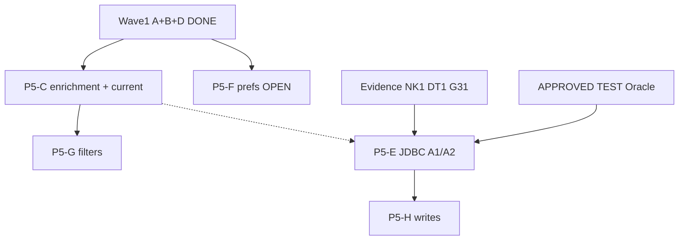

# ASUOP — предложение P5 Wave 2 (после Wave 1)

Дата: **2026-11-24**. База: `main` @ `4b92a80` (после PR #25 Wave 1 completion report).  
**Docs-only proposal.** Не заменяет [APPROVALS_TEMPLATE.md](../architecture/APPROVALS_TEMPLATE.md).  
Код Wave 2 — только после отдельных строк APPROVED и human merge approval PR.

Связано: [ASUOP_P5_NUFF_FUNCTIONAL_PLAN.md](ASUOP_P5_NUFF_FUNCTIONAL_PLAN.md), [P5_WAVE1_COMPLETION_REPORT.md](P5_WAVE1_COMPLETION_REPORT.md), [53](../architecture/53_P5_NUFF_TEST_MATRIX.md), [41](../architecture/41_P4_0_R1_R3_FIELD_MAPPING.md), [49](../architecture/49_NK1_DT1_G31_OFFLINE_RESEARCH.md), [50](../architecture/50_P4_2_GO_NOGO_CREATE_RAILDB_TEST.md).

---

## 0. Исходное состояние

| Контур | Статус |
| --- | --- |
| Wave 1 CODE (P5-A/B/D) | **DONE** на `68564a5`; report PR #25 @ `4b92a80` |
| P5-C / E / F / G / H | **DENIED UNTIL APPROVED** |
| Create RAILDB / JDBC / Flyway / live FTP·RWL / writes | **DENIED** |
| G31 | **OPEN** |
| NK1 / DT1 | **BLOCKED** |
| R1 JDBC against TEST Oracle | **DENIED UNTIL APPROVED** |

Wave 2 = (1) synthetic read/UX slices ещё без Oracle + (2) параллельный evidence track для G31/NK1/DT1 + (3) опционально JDBC parity после TEST.

---

## 1. Оставшиеся срезы C/E/F/G/H

### 1.1 Сводная таблица

| ID | Суть | Можно без Oracle? | Блокеры | Рекомендация Wave 2 |
| --- | --- | --- | --- | --- |
| **P5-C** | Registry enrichment + optional current-state на карточке (synthetic) | Да | Owner field list | **Включить в Wave 2A** |
| **P5-G** | Multi-field filter criteria (synthetic) | Да | Owner semantics | **Включить в Wave 2A** (после/с C) |
| **P5-F** | localStorage prefs / multi-card tabs | Да | Owner prefs policy | **Опционально Wave 2A** отдельной строкой |
| **P5-E** | JDBC read A1/A2 + parity IT | Нет | TEST Oracle + ideally NK1/DT1 | **Wave 2B** после gates |
| **P5-H** | Writes / bulk / concurrency | Нет | Legacy write evidence + ADR-0007/0009 writer | **Вне Wave 2** (оставить DENIED) |

### 1.2 Зависимости

Параллельно с Wave 2A: DBA evidence track (не CODE NUFF).

---

## 2. Точный объём следующей реализации (предлагаемый Wave 2A)

**In scope (после APPROVED строк):** только synthetic/offline; Java+React уже в стеке; additive REST где указано; Vitest + MockMvc + Playwright; Independent QA Test Runner на срез.

### P5-C — Registry enrichment + optional current-state (synthetic)

**Цель:** оператор видит паспортные колонки в реестре и блок «текущее состояние» на карточке без претензии на legacy/Oracle parity.

**Backend (additive, non-breaking):**
- `WagonRegistryItem` / DTO: добавить поля зеркала A2 passport (как на карточке):  
  `model`, `wagonKind`, `ownerName`, `homeStationCode`, `homeStationName`, `inventoryPark`.  
  `wagonCode` остаётся; paging/sort/search contract без breaking change.
- `WagonCard` / DTO: optional nested `currentState` (или плоские nullable fields):  
  `stationCode`, `operationCode`, `dislocationTime`, `trainIndex` (из synthetic current fixture / catalog).  
  **Явно в тестах:** current ≠ last day line (правило R1).
- Synthetic adapters заполняют поля из существующего catalog/card fixtures; без Oracle.

**Frontend:**
- `WagonRegistryGrid`: колонки enrichment.
- `WagonCardPanel`: секция current-state (пусто/нет данных — empty, не ошибка).
- Не менять day semantics / watched FIXTURE honesty (P5-D).

**Out of C:** JDBC; SaveWagon; claims of LOCATION* writer (G3/G4); Enterprise AG Grid.

**Приёмка:** MockMvc registry page содержит новые поля; card current documented; FE Vitest+Playwright; size≤200; Wave 1 e2e green.

**Owner must confirm field list** (предложенный список выше = default proposal).

### P5-G — Filter criteria port (synthetic)

**Цель:** явный criteria object для реестра/слежения (не только `search` contains).

**Backend:**
- `WagonRegistryCriteria` / watched criteria: как минимум  
  - `codeContains` (текущий search)  
  - optional `ownerContains` (synthetic string match)  
  - optional `wagonKindEquals` (exact on fixture enum/string)  
  Invalid combo → 400. Document: **не** Oracle LIKE parity.
- Query params additive (`owner`, `kind`) или единый criteria; сохранить совместимость пустых params = текущее поведение.

**Frontend:** filter inputs на registry (и опционально watched); URL sync через существующий deep-link pattern (расширить params) — согласовать с P5-A URL model.

**Depends on:** P5-C желателен (фильтр по owner/kind осмысленнее с колонками); можно стартовать после C merge.

**Out of G:** JDBC predicate claims; full-text; Enterprise filters.

### P5-F — Prefs / multi-card (optional)

**Только после owner policy:**
- `localStorage` keys: `asuop.fleet.pageSize`, `asuop.fleet.lastTab` — no PII/secrets.
- Multi-card tabs: FE-only open cards; close ≠ write API; deep-link остаётся single `wagon=` (**OPEN** product choice).

Если owner не утверждает policy — **оставить DENIED**, не включать в Wave 2A CODE.

### P5-E — JDBC A1/A2 (Wave 2B, отдельный gate)

**Предусловия (все):**
1. Строка **R1 JDBC against TEST Oracle** = APPROVED (URL/RO creds вне Git).
2. Желательно: NK1/DT1 evidence (хотя бы hour sample) — иначе day parity пометить LIMITED.
3. G31 **не** требуется для A1/A2 card/day; watched остаётся empty/FIXTURE.

**Объём:** bind SQL read adapters; enable `JdbcParityIT` только под gate; no write; no prod; no Flyway.

### P5-H — вне Wave 2

Оставить DENIED. Нужны: legacy `SaveWagon` field evidence, concurrency model, write APPROVALS, ADR-0007/0009 writer rules. Не предлагать CODE в этой волне.

---

## 3. G31 / NK1 / DT1 — недостающие доказательства и как получить

Источник: [49](../architecture/49_NK1_DT1_G31_OFFLINE_RESEARCH.md). **Не закрывать** без DBA exports + owner pick.

### 3.1 NK1 (BLOCKED)

| Недостаёт | Как получить | Артефакт |
| --- | --- | --- |
| Duplicate frequency `(REPORT_ID,WAGON_ID)` / `(WAGON_ID,GETTING_DATE)` за **1 час** | APPROVED TEST/RO + tape access plan; EXPLAIN PASS; SQL `sql/dba/p4-2/NK1_*` | CSV ≤200 groups |
| Content diversity colliding pairs | NK1.3 sample | CSV ids only |
| Hour volume | NK1.4 COUNT in indexed hour | CSV |
| Owner decision: retain-all forever vs UK later | After samples | APPROVALS note |

**Hold until then:** retain-all; no DISTINCT/UK on business natural key.

### 3.2 DT1 (BLOCKED)

| Недостаёт | Как получить | Артефакт |
| --- | --- | --- |
| Pairwise getting vs location deltas (EQUAL / ±1h / >24h / NULL) | Same tape gate; `DT1_*` SQL drafts | CSV buckets |
| Kit-hour alignment report vs tape | DT1.3 | CSV |
| Operator meaning of «сутки» (+ **R1-Q-TZ**) | Owner product decision after samples | APPROVALS / ADR note |

**Hold until then:** filter/day axis = **GETTING**; store-both; UI disclosure.

### 3.3 G31 (OPEN)

| Недостаёт | Как получить | Артефакт |
| --- | --- | --- |
| Package SPEC text `GetActiveWagonList` / predicate | DBA grant or file export SPEC (doc 38); `G31_package_source_discovery.sql` — **no EXECUTE** | SPEC export / CSV args |
| Cursor columns | ALL_ARGUMENTS / SPEC | CSV |
| Business pick: Active vs wagons.txt vs cutover snapshot | Owner after SPEC | APPROVALS + product rule |
| Optional cursor materialization | **Separate** APPROVED | later |

**Hold until then:** RAIL watched empty; M8 SKIP; FIXTURE ≠ Active (Wave 1 P5-D).

---

## 4. Рекомендуемый порядок и APPROVALS

### Wave 2A (synthetic CODE) — рекомендуемый owner pick

1. Docs approval PR: строки **P5-C**, **P5-G** → APPROVED WITH CONSTRAINTS (+ optional **P5-F**).  
2. CODE PR **P5-C** → Independent QA → human merge.  
3. CODE PR **P5-G** (rebase on C) → QA → merge.  
4. Optional **P5-F** после policy.

### Parallel evidence (не CODE NUFF)

| Gate | Что |
| --- | --- |
| DBA fills [43](../architecture/43_ADR0009_DBA_CREATE_CHECKLIST.md) | Create RAILDB TEST readiness |
| Separate APPROVED: tape EXPLAIN + NK1/DT1 SELECTs | Close BLOCKED → evidenced |
| Separate APPROVED: G31 SPEC export | Enable business pick |
| Separate APPROVED: Create RAILDB TEST | [50](../architecture/50_P4_2_GO_NOGO_CREATE_RAILDB_TEST.md) |
| Separate APPROVED: R1 JDBC TEST | Unlock P5-E |

### Wave 2B

5. **P5-E** only after TEST JDBC APPROVED.  
6. **P5-H** not in Wave 2.

---

## 5. Тестовая матрица Wave 2 (sketch)

| Slice | Must pass | Must not claim |
| --- | --- | --- |
| P5-C | MockMvc additive fields; FE columns; current ≠ last day line; Wave 1 e2e green | Oracle passport parity |
| P5-G | 400 invalid; empty filters = old behavior; URL round-trip; size≤200 | Oracle LIKE / index truth |
| P5-F | prefs keys documented; no secrets | Cross-browser sync |
| P5-E | Parity IT vs legacy keys on TEST | Prod JDBC; writes; G31 closed |
| Evidence | Sanitized CSV only; no secrets in Git | UNKNOWN as CONFIRMED |

Channel: Independent `/qa-test-runner` per CODE PR.

---

## 6. Риски

| Риск | Митигация |
| --- | --- |
| Field list drift on C | Owner locks list in APPROVALS row |
| Filter semantics invented as legacy | Mark OPEN; synthetic-only docs |
| Prefs storing PII | Ban; only pageSize/lastTab |
| Starting E without TEST | Keep DENIED |
| Closing G31/NK1/DT1 from synthetic | Forbidden |
| Mixing Create RAILDB into Wave 2A | Separate track |

---

## 7. Stop line (этот docs PR)

**Разрешено:** merge docs-only Wave 2 proposal + draft APPROVALS wording.  
**Запрещено до owner APPROVED на срезы:** любой CODE C/E/F/G/H; Oracle connect; Create RAILDB; Flyway; closing gaps without evidence; auto-merge.

**Решение владельца (нужно выбрать):**

1. Утвердить **Wave 2A = P5-C + P5-G** (рекомендация)?  
2. Включить **P5-F** сейчас или отложить?  
3. Подтвердить **field list** для P5-C (предложенный в §2)?  
4. Запускать ли параллельно DBA evidence (NK1/DT1/G31) и/или Create RAILDB TEST checklist?  
5. **P5-E / P5-H** — явно отложить (рекомендация).
