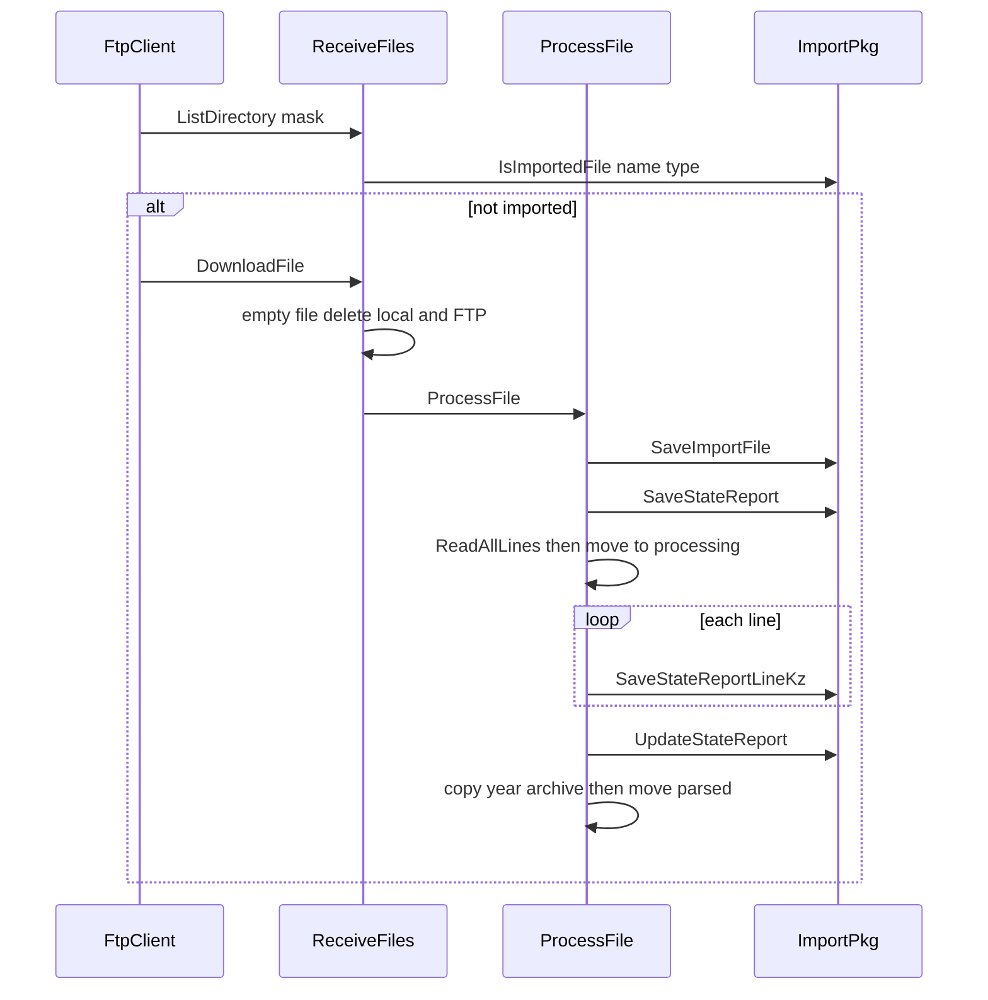

# АСУ-ВП: конвейер импорта среза

Источник: [01](01-asuvp-hourly-import.md). Основной сценарий этого документа — текстовый срез KZ. Соседние маски перечислены отдельно. Тела `ImportPkg` не читались.

Класс: `RemoteLib.GivingDepartures.ImportStateReportsFtp` в `Старая программа/Сервис приложение/.../RemoteLib.dll`.

## Путь одного файла KZ

Методы по порядку:

1. `Run` ставит таймер. Период — `FtpStateReportsReceiveInterval` секунд (эталон 45).
2. `ReceiveFiles`: если `_startedProcess`, выход. Иначе `CopyFromFtpServer(FtpDirectoryPath + DirSearchPatternKZ)`.
3. `CopyFromFtpServer`: `FtpClient.ListDirectory`. Уже лежащий локально файл не качается. Если `IsImportedFile` ложь — `DownloadFile` в `FtpDirectoryPathImport` (`\tmp\ftp\`). Файл нулевой длины удаляется локально и на FTP и в Oracle не регистрируется. Если `CopyTisServiceDislocation` — `UploadFile` на `TisServiceDislocationPath` (`//tisservice//disl_kz//`). Вызов заливки стоит после проверки длины и выполняется и для только что удалённого пустого файла. Уже импортированный файл старше `FtpSaveDaysFile` дней (эталон: 1) удаляется с FTP.
4. Локальные файлы по маске: снова `IsImportedFile(имя)`. Если ложь — `ProcessFile`.
5. `ProcessFile`: `OpenConnection` → `SaveImportFile` → `SaveStateReport` → `File.ReadAllLines` → перенос в `\tmp\ftp\processing\` → `SaveLines` → `UpdateStateReport` → копия в каталог `CopyDirectoryStateReportsNew` + год → перенос в `processing\parsed\`.
6. `SaveLines` вызывает `SaveStateReportLine` на **каждую** строку, включая неизменившиеся. Фильтра «вагон не двигался» в C# нет.

Исключение `ReceiveFiles` и `ProcessFile` ловится, пишется в syslog и глотается. Флаг `_startedProcess` снимается в `finally`.

## Формат строки KZ

Разделитель — табуляция. `SaveStateReportLine` передаёт в `ImportPkg.SaveStateReportLineKz`:

| Индекс | Параметр |
|---|---|
| 0 | `wagonCode` |
| 1 | `dislocationStationCode` |
| 2 | `trainIndex` |
| 3 | `dislocationDate` |
| 4 | `operationCode` |
| 5 | `destinationStationCode` |
| 6 | `departureStationCode` |
| 7 | `receiverCode` |
| 8 | `senderCode` |
| 9 | `wagonType` |
| 10 | `wagonOwner` (`"нет информации"` → 0, иначе `Int32`) |
| 11 | `nodCode` |
| 12 | `weigthState` |
| 13 | `workState` |
| 14 | `docNumber` (Trim) |
| 15 | `cargoCode` |
| 16 | `cargoWeigth` |
| 17 | `capacity` |
| 18 | `messageCode` |
| 19 | `operationDate` |
| 20 | `containers`, только если полей ровно 21; иначе `DBNull` |

Другой проверки формата нет. Короткая строка даёт исключение на индексе, строка логируется (`SaveStateReportLineKz Error`) и пропускается. Остальные строки продолжаются. Образцов `disl_kz*.txt` в workspace нет.

## Полный срез и файл изменений

Отдельного алгоритма «полный почасовой файл» и «дельта за час» в C# нет. Любой непустой файл маски целиком уходит в `SaveStateReportLine*`.

| Канал | Что это в коде | Не является |
|---|---|---|
| `disl_kz*.txt`, тип 0 | основной текстовый срез KZ | — |
| `disl_operations*.txt`, тип 1 | срез RU (`ImportStateReportsFtpRu`), 11 полей, другой порядок | доказанной дельтой KZ |
| `disl_cis*.txt` | та же задача RU, но маска копии пользователя | дельтой KZ |
| `disl_vagons_cis*.txt`, тип 2 | TIS RU, процедура строки KZ | дельтой KZ |
| `disl_vagons_all_*.txt`, тип 16 | третьи стороны, процедура строки KZ | дельтой KZ |
| `disl_containers_*.txt`, тип 3 | контейнеры, пропуск заголовка | срезом вагонов |
| `*_disl_kz.xls`, тип 23 | Excel через макрос `ImportStateReportXlsImportTypeId=221` | текстовым почасовым файлом |

Если поставщик кладёт в `disl_kz*.txt` полный список, сервис сохранит все строки этого файла. Отбрасывает ли Oracle строку без движения — в клиенте не видно.

## Около 18 000 состояний

Два разных механизма:

1. **Список на слежение.** `GivingDeparture.PublishRegistryStateReports` пишет `wagons.txt` и может залить его на FTP (`TisServiceWagonsPath`). На диске копии пользователя 18334 кода. Это не почасовая история.
2. **Срез.** Сохранение всех состояний часа возможно только если входной файл их содержит: `SaveLines` не выкидывает «неподвижные» строки. Таймер 45 секунд час не формирует.

## Сбой посередине

Транзакции на TXT-файл нет. `BeginTransaction` есть только у `ImportStateReportsXls.SaveFileContent` (LOB `ImportPkg.SaveFileContent`, `Commit`/`Rollback` этого вызова).

Поведение KZ при обрыве:

- Ошибка одной строки не останавливает цикл `SaveLines`.
- `SaveImportFile` и `SaveStateReport` при ошибке пишут syslog и возвращают `0`, **не пробрасывая** исключение. `ProcessFile` тогда продолжает строки с нулевым идентификатором.
- Файл переносится в `processing` **до** `SaveLines`. В `parsed` и в годовой архив — только если путь дошёл до копирования. Исключение после переноса в `processing` оставляет файл там; `ProcessFile` его не возвращает во входной каталог.
- Следующий опрос обрабатывает локальные файлы только из `FtpDirectoryPathImport` по маске, не из `processing`. Застрявший в `processing` файл сам не подхватится.
- Повтор по имени отсекается `Importpkg.IsImportedFile(filename, type)` до `ProcessFile`. Становится ли файл «импортированным» уже после `SaveImportFile` или только после `UpdateStateReport` — решает тело пакета. Его нет в workspace. Если признак ставится в начале, оборванный файл **больше не импортируется**, и в базе остаётся неполный набор строк.

Пустой файл в Oracle не пишется.

## До отображения в НУВ

`LoadWagonStateReports` запрашивает сутки: начало дня `00:00:00`, конец `23:59:59`, курсор `result`. Что именно вернёт пакет при неполном часе, без PL/SQL неизвестно.
