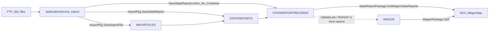
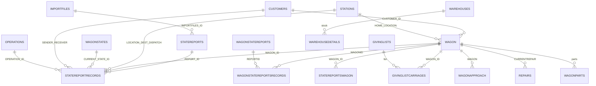

# Связи сущностей Oracle (`DBTC`)

База: сессия `tc-asuvp-03` / схема `DBTC` (см. [02_ORACLE_TABLES.md](02_ORACLE_TABLES.md)).  
FK — `ALL_CONSTRAINTS` (`constraint_type='R'`) + `ALL_CONS_COLUMNS`. Писатели/читатели — пакетные spec + анализ DLL (`docs/analysis/01`, `04`).

## 1. Поток данных: АСУ-ВП пишет, НУВ читает

**Пишет АСУ-ВП (сервис импорта)** через `DBTC.IMPORTPKG` (spec подтверждён в `ALL_SOURCE`):

| Процедура | Целевые таблицы (по именам/FK/контракту) |
|---|---|
| `SaveImportFile`, `IsImportedFile`, `SaveFileContent` | `IMPORTFILES`, `IMPORTFILESCONTENT_TMP` |
| `SaveStateReport`, `SaveStateReportLineKz/Ru/Container`, `UpdateStateReport`, `UpdateStateReportXml` | `STATEREPORTS`, `STATEREPORTRECORDS` (+ tmp) |
| `SaveGivingReportLine*`, `Save*ManufactoryReportLine*`, `UpdateGivingDeparture`, `CreateJobUpdateGivingDeparture` | `GIVINGDEPARTURE*`, списки подачи/уборки |
| `SaveRegistryMainReportLine*`, `CreateJobUpdateRegistryMain` | реестры (`GIVINGDEPARTURESREGISTRY` / registry tables) |

**Читает НУВ** (не вызывает `ImportPkg` на чтение среза):

| Пакет | Назначение | Таблицы |
|---|---|---|
| `STATEREPORTPACKAGE` | «пакет для работы с … срезами»; `GetWagonStateReports`, `GetStateReports`, `LoadStateReports*` | `STATEREPORTS`, `STATEREPORTRECORDS` (`%ROWTYPE` в spec) |
| `WAGONPACKAGE` | списки/карточка вагона | `WAGON` + справочники |
| `GIVINGPKG` / `GIVINGDEPARTUREPACKAGE` / `APPROACHPKG` | подача/уборка/подход | `GIVING*`, `WAGONAPPROACH*` |
| `WAGONSTATEREPORTSPKG` | документные срезы | `WAGONSTATEREPORTS*` |

## 2. Карта главных сущностей (FK)

### Якорные FK-узлы (высокая связность)

| Таблица | FK входящие (приблизительно) | Роль |
|---|---:|---|
| `STATIONS` | 83 | станции почти везде |
| `CUSTOMERS` | 51 | отправитель/получатель/предприятие |
| `USERS` | 29 | аудит/оператор |
| `WAGON` | 27 | центр домена |
| `CARGOTYPES` | 25 | грузы |
| `WAGONTYPES` | 19 | тип вагона |
| `WAREHOUSES` | 12 | склад НУД |
| `GIVINGLISTS` / `DEPARTURELISTS` | 11 / 11 | подача/уборка |

Источник: агрегация `ALL_CONSTRAINTS` R → parent table.

### Таблицы с наибольшим числом исходящих FK

`WAGON` (15), `STATEREPORTRECORDS` (13), `GIVINGDEPARTURES` (13), `GIVING`/`GIVINGARCHIVE` (12), `WAGONSTATEREPORTSRECORDS` (12), `STATEREPORTSWAGON` (10).

## 3. Текущее / срез / события

| Слой | Объекты | Как связаны |
|---|---|---|
| Current | `WAGON`, `GIVING`, `WAGONAPPROACH`, `CURRENTPARTS` | живые строки; на `WAGON` дублируются поля дислокации |
| Snapshot batch | `IMPORTFILES`→`STATEREPORTS`→`STATEREPORTRECORDS` | каждый импорт = заголовок + N строк; `STATEREPORTS.LAST` помечает последний |
| Snapshot derived | `STATEREPORTSWAGON` | по вагону; наполняется jobs/пакетами (не FTP напрямую) |
| Manual snapshot | `WAGONSTATEREPORTS*` | через `SYS_DOCUMENTS` |
| Event/archive | `*ARCHIVE`, `WAGONDOWNTIME`, `WAGONMILEAGE`, `PARTSREMOVED`, `SYS_*HISTORY` | отделены именем и объёмом |

Не доказано словарём: пишет ли `UpdateStateReport` сразу в `WAGON` (гипотеза до чтения body). В spec есть `UpdateLastReport`, `RefreshStateReport`, `CheckWagon` — косвенно указывает на обновление текущего состояния после среза.

## 4. Общие объекты нескольких приложений

| Объект | НУВ | УВП | НУД | Импорт-сервис | Отчёты |
|---|---|---|---|---|---|
| `WAGON` + справочники | R/W | R/W | R | R (резолв кода) | R |
| `STATEREPORTS` / `STATEREPORTRECORDS` | R | R | — | **W** | R |
| `GIVING*` / approach | R/W | — | — | **W** (файлы) | R |
| `REPAIRS` / `WAGONMILEAGE` | R | R/W | — | job mileage | R |
| `WAREHOUSE*` / parts | R (части) | R/W parts | **R/W** | — | — |
| `STATIONS` / `CUSTOMERS` | R | R | R | R | R |
| `WAGONSMESSAGES` | R/W | R/W | — | W (задачи 2610/2612) | — |

Места высокой связности: **`STATIONS`**, **`WAGON`**, **`CUSTOMERS`**, **`STATEREPORTRECORDS`** (объём + 13 FK), цепочка подачи `GIVINGLISTS`↔`GIVINGLISTCARRIAGES`↔`WAGON`.

## 5. Граница с АСУОП

Клиент АСУОП работает с MSSQL `terminal`. Oracle-пакет `ASOUPPKG` и таблица `WAGONSMESSAGES` обслуживают ApplicationService / WagonApp, не `cncClient` напрямую ([07-asuop-reverse.md](07-asuop-reverse.md)).
