# Зависимости SQL-объектов `DBTC`

Два слоя, их нельзя смешивать:

- **Факт словаря** — `ALL_DEPENDENCIES` и тела, которые учётка видит (триггеры, 19 автономных процедур, текст job).
- **Вывод** — сигнатуры spec, `%ROWTYPE`, имена, FK этапа 2, `CommandText` DLL. Так помечены рёбра, которых в `ALL_DEPENDENCIES` нет.

Сессия: `ASUVP_SERVICE` @ `tc-asuvp-03`, схема `DBTC`. Пакеты не выполнялись.

`PACKAGE BODY` не виден, поэтому рёбра пакет → таблица почти пустые: 5 штук на всю схему. Зависимости пакетов друг на друга в словаре — это `STANDARD`, кроме `REPORTSPKG` → `DIRECTORIES`.

## 1. Что словарь реально связал

| Откуда | Куда | Строк |
|---|---|---:|
| VIEW | TABLE | 273 |
| VIEW | PACKAGE | 15 |
| VIEW | VIEW | 6 |
| PROCEDURE (автономные) | PACKAGE | 57, из них содержательные — ниже |
| PROCEDURE | TABLE | 41 |
| PACKAGE | TABLE | 5 |
| PACKAGE | PACKAGE | почти только `STANDARD`; исключение `REPORTSPKG` → `DIRECTORIES` |
| PACKAGE | TYPE | 14 |

### Пакет → таблица (факт)

| Пакет | Таблица |
|---|---|
| `STATEREPORTPACKAGE` | `STATEREPORTRECORDS` |
| `GIVINGDEPARTUREPACKAGE` | `STATEREPORTRECORDS` |
| `WORKLISTSPKG` | `WORKLISTS` |
| `REQUESTPACKAGE` | `REQUEST` |
| `PERMISSIONS` | `USERS` |

`ImportPkg`, `RepairsPkg`, `PartsPackage`, `WarehousePkg`, `WagonPackage` в этом списке **отсутствуют**. Их таблицы ниже — вывод.

### View → пакет (факт)

Представление вызывает функцию пакета. Текст view не копировался.

| View | Пакет |
|---|---|
| `WAGONVIEW` | `REPAIRSPKG` |
| `REPAIRSVIEW`, `LASTREPAIRVIEW`, `LASTREPAIRSVIEW`, `LASTPLANREPAIRSVIEW`, `OWNWAGONSVIEW` | `REPAIRSPKG` |
| `PLAN_REPAIRS_VIEW` | `REPAIRDATES_PKG` |
| `LIFETIMEWAGONPARTSVIEW` | `PARTSPACKAGE` |
| `TM_WAGONVIEW` | `STATEREPORTPACKAGE` |
| `STAGESVIEW` | `STAGEPKG` |
| `BUDGETVIEW`, `REQUESTVIEW` | `PLANNINGVOLUMEPKG` |
| `TRANSPORTREQUESTVIEW`, `TRANSPORTREQUESTITEMVIEW` | `TRANSPORTREQUESTPKG` |
| `WORKINGSHEETTIMEVIEW` | `WORKINGSHEETPACKAGE` |

Следствие: отчёт или экран на `WAGONVIEW` / `TM_WAGONVIEW` тянет не только таблицу `WAGON`, но и скрытое тело `RepairsPkg` или `StateReportPackage`.

### View → таблица для приоритетных представлений (факт)

| View | Таблицы |
|---|---|
| `WAGONVIEW` | `WAGON` |
| `TM_WAGONVIEW` | пакет `STATEREPORTPACKAGE` (таблица в этой проекции зависимостей не всплыла отдельно) |
| `REPORTRECORDS` | `STATEREPORTRECORDS` |
| `REPAIRSVIEW` | `REPAIRS` |
| `CURRENTREPAIRVIEW`, `LASTREPAIRVIEW`, `LASTREPAIRSVIEW` | `REPAIRS`, `WAGON` |
| `PLAN_REPAIRS_VIEW` | `WAGON`, `WAGONMODELS` |
| `REPAIRBUDGETVIEW` | `REPAIRBUDGET` |
| `WAGONMILEAGEVIEW` | `WAGONMILEAGE` |
| `WAGONDOWNTIMEVIEW` | `WAGONDOWNTIME` |
| `PARTSAFTERVIEW` | `PARTSAFTER`, `PARTTYPES`, `WAGONPARTS` |
| `GIVINGLISTSVIEW` | `GIVINGLISTS` |
| `GIVINGLISTCARRIAGESVIEW` | `GIVINGLISTCARRIAGES` |
| `GIVINGDEPARTURESVIEW` | `GIVINGDEPARTURES`, `STATIONS`, `CARGOKTZ`, `WAGONTYPES`, `WAGONOWNERS`, `AFFILIATIONS`, `ADMINISTRATIONREGISTRY`, `CURRENCY`, `PAYERS` |
| `GIVING_ROUTE_REPORT_VIEW` | `GIVING_ROUTES_VIEW` (в зависимостях это таблица, не view) |
| `WAGONSTATEREPORTSVIEW` | `WAGONSTATEREPORTS`, `SYS_DOCUMENTS`, `USERDETAILS` |
| `KPIVALUESVIEW` | `KPIVALUES`, `KPINAMES` |

### Автономная процедура → пакет и таблица (факт)

| Процедура | Пакеты | Таблицы |
|---|---|---|
| `SP_ADDCONTEINER` | — | `WAGON` |
| `SP_ADDSTATION` | — | `STATIONS` |
| `SP_ADDWAGONGIVINGDEPARTURE` / `2` | `WAGONPACKAGE`, `STATIONSPACKAGE` | `CUSTOMERS`, `REPORT1` / `REPORT2` |
| `SP_ARRIVALWAGONPARTS` | `WAREHOUSEPKG` | `WAGONPARTS`, `PROCUREMENT`, `PROCUREMENTDETAILS`, `TRANSFERDOCUMENTS`, `WAREHOUSES`, `PARTTYPES`, `CUSTOMERS` |
| `SP_ARRIVEWHEELPAIR` | — | `ARRIVALDOCUMENTS`, `ARRIVALDETAILS`, `WAGONPARTS`, `WAREHOUSES`, `REPAIRPLANTS` |
| `SP_TRANSFERWAGONPART` | `UTILSPKG` | `TRANSFERDETAILS`, `TRANSFERDOCUMENTS`, `WAGONPARTS`, `WAREHOUSES`, `PROCUREMENT`, `REPAIRPLANTS` |
| `SP_CONVERTREPAIRSTOTR1` | `WAGONPACKAGE` | `REPAIRS` |
| `SP_GETMILEAGE` | `WAGONPACKAGE` | `WAGONMILEAGE` |
| `SP_WAGONEXCLUDE` | `REPAIRSPKG` | `WAGON`, `WAGONEXCLUSION`, `REPAIRS`, `CUSTOMERS` |
| `SP_UPDATEWAGONGROUP` / `GRREGISTRATION` | `WAGONPACKAGE`, `DIRECTORIES` | `WAGON`, `WAGONGROUPS` |
| `SP_INSERTREASON` / `SP_UPDATEREASON` | `DIRECTORIES` | `REASONS` |
| `SP_UPDATESTATIONCOORDINATES` | `STATIONSPACKAGE` | `STATIONS` |
| `SP_UPDATESTATIONSDISTANCE` | `STATIONSPACKAGE` | `STATIONSDISTANCE` |
| `SP_IMPORTCARGOKTZ` | — | `CARGOKTZ` |
| `SP_IMPORTWAGONOWNER` | — | `WAGONOWNERS` |
| `UPDATEWAGONTARWEIGHT` | — | `WAGON` |

### Триггер → объект (факт тела)

| Триггер | Вызов |
|---|---|
| `TR_REPAIRS_TIME`, `TR_PLAN_REPAIRS_TIME` | `TIMESPKG.WRITETIME` |
| `TR_STATIONS_CHANGED` | `UPDATE LASTCHANGETIMES` |
| `TR_*_ID` | sequence, без пакетов |

### Job → объект (факт `JOB_ACTION`)

| Job | Вызов | Включён |
|---|---|---|
| `WAGONUPDATE` | `WAGONUPDATEDISL.WAGONUPDATEDISLTIS` | да. Объект не виден |
| `PIUPIU` | `WAGONUPDATEDISL.UPDATEDISLOCATIONLAST` | нет |
| `DELETEROWSIMPOORTFILES` | `WAGONUPDATEDISL.DELETEROWSIMPORTFILES` | нет, STOPPED |
| `FILLREF`, `FILLREF_WEEKENDS` | `REFERENCESFILL` | да. Объект не виден |
| `DELETESTATIONDUBLICATE` | `RUNSTATIONDUBLICATESDELETE` | нет. Объект не виден |
| `AVAILABILITY_VIEW_JOB` | `RESOURCEPKG.UPDATEAVAILABILITYVIEW` | да |
| `UPDATEWAGONMONTHDISTANCESDAILY` | `RESOURCEPKG.WRITEWAGONSDISTANCEDAYLI` | да |
| `FILLGIVINGREPORTS` | `GIVINGDEPARTUREREPORTS.FILLGIVINGREPORTS2` | да |
| `FILLKPI` | `KPIPKG.FILLKPI` | да |
| `UPDATEALLREPAIRDATES` | `JOBPKG.UPDATEALLREPAIRDATES` | да |
| `UPDATEEXCESSINACTIVITY` | `GIVINGDEPARTUREPACKAGE.GETEXCESSINACTIVITY` и `UPDATE GIVINGLISTCARRIAGES` | да |
| `UPDATEREGISTRYMAIN` | цикл по `IMPORTFILES` | да |
| `FILLSTATEREPROTSWAGONSTATIONS` | `STATEREPORTSWAGONPACKAGE.FILLSTATEREPORTSWAGONSTATIONS` | нет, FAILED |
| `ROTATEREPAIRDETAILS` | `PARTSPACKAGE.ROTATEREPAIRDETAILS` | нет |
| `UPDATEPS_*` | `STATEREPORTPACKAGE.UPDATEPREVSTATIONS`, `UPDATEPREVIOUSLOADINGSTATIONS` | нет |
| `UPDATEGSP_*` | `GRAPHSHEETPACKAGE.UPDATESTATEREPORTS` | нет |
| `WAGONTHROWINGCALCMANUALLY` | `WAGONTHROWINGPKG.CALCTHROWINGPERIODWAGONS` | нет, STOPPED |

## 2. Приложения → члены пакетов (вывод из DLL)

Имена сверены со spec: перечисленные члены в `ALL_PROCEDURES` есть. `AdminPkg` из старых документов отдельным пакетом `DBTC` **не найден**.

```mermaid
flowchart TB
  svc[ApplicationService_import]
  nuv[NUV_WagonApp]
  uvp[UVP_WagonApp]
  nud[NUD_WarehouseApp]
  rpt[Reports_in_clients]

  svc --> importPkg[ImportPkg]
  svc --> asoup[AsoupPkg]
  nuv --> srp[StateReportPackage_Get]
  nuv --> wp[WagonPackage_Get]
  nuv --> giving[GivingPkg_and_GivingDeparturePackage]
  nuv --> approach[ApproachPkg]
  nuv --> work[WorkListsPkg]
  uvp --> srp
  uvp --> wp
  uvp --> repairs[RepairsPkg]
  uvp --> budget[RepairBudgetPkg]
  uvp --> parts[PartsPackage_Get]
  nud --> wh[WarehousePkg]
  nud --> parts
  rpt --> srp
  rpt --> wp
  rpt --> down[DownTimePkg_Get]
  rpt --> reports[ReportsPkg]
  rpt --> budget
```

| Приложение | Члены, подтверждённые DLL и spec |
|---|---|
| АСУ-ВП импорт | `ImportPkg.IsImportedFile`, `SaveImportFile`, `SaveStateReport`, `SaveStateReportLineKz`, `SaveStateReportLineRu`, `SaveStateReportLineContainer`, `UpdateStateReport`, `SaveFileContent`, `UpdateStateReportXml`, `SaveGivingReportLine*`, `SaveRegistry*`, `Save*ManufactoryReportLine*`, `CreateJobUpdateGivingDeparture`, `CreateJobUpdateRegistryMain` |
| АСУ-ВП, сообщения | `AsoupPkg.LoadWagonsMessages2610`, `LoadWagonsMessages2612`, `SetSendedWagon` (в spec также `2731`, `SetReceivedWagon`) |
| НУВ | `StateReportPackage.GetWagonStateReports`, `GetStateReports`, `DeleteReport`; `WagonStateReportsPkg.GetPublishWagonsThird`; `WagonPackage.GetWagonList`, `GetWagonByCode`, `GetActiveWagonList`, `GetContainerList`, `GetMonthDistances`; `ApproachPkg.GetApproachWagons`; `WorkListsPkg.UpdateStateReport` |
| УВП | те же чтения среза и вагона; `RepairsPkg.GetRepairList`, `GetWagonRepairs`, `LoadMileAgeWagons`, `LoadMileAgeWagonsEveryDay`, `ImportMileageWeb`, `Register`, `ImportWagonParts2731`; `RepairBudgetPkg.GetRepairBudgetData`; `PartsPackage.GetHistoryState`, `LoadPartHistory` |
| НУД | `WarehousePkg.RegisterArrivalDocument`, `UnregisterArrivalDocument`, `RegisterProcurementDocument`, `RegisterRepairDocument`, `RegisterTransferDocument`, `RegisterWritingOffDocument`, `RegisterDetailsWorkingSheet`, `RegisterWheelPairRepair`; `PartsPackage` |
| Отчёты | `StateReportPackage` чтения, `WagonPackage.GetWagonsInventoryDataOLAP`, `DownTimePkg.GetWagonDownTime`, `RepairBudgetPkg`, `ReportsPkg` |

## 3. Член → таблицы (вывод, не словарь)

| Член | Читает | Меняет |
|---|---|---|
| `ImportPkg.IsImportedFile` / `SaveImportFile` | `IMPORTFILES` | `IMPORTFILES` при save |
| `SaveStateReport` / `SaveStateReportLine*` / `UpdateStateReport` | справочники станций, вагонов, операций | `STATEREPORTS`, `STATEREPORTRECORDS`. Запись в `WAGON` не доказана |
| `StateReportPackage.GetWagonStateReports` | `STATEREPORTRECORDS` (факт зависимости пакета) | не должен; тело не видно |
| `StateReportPackage.UpdatePrevStations` | лента среза | предыдущие станции в строках среза (вывод по имени) |
| `WagonPackage.Get*` | `WAGON` и справочники | нет на уровне имени |
| `WagonPackage.SaveWagon` | справочники | `WAGON` |
| `RepairsPkg.Get*` / `Register` / `ImportMileage*` | `REPAIRS`, `WAGONMILEAGE` | `Register` и `Import*` — запись, объём неизвестен |
| `PartsPackage.GetHistoryState` | история деталей | нет на уровне имени |
| `WarehousePkg.Register*` | документы склада | `WAREHOUSE*`, `*DETAILS` |
| `GivingDeparturePackage` (пакет) | `STATEREPORTRECORDS` (факт) | списки подачи — вывод по именам `Save*` |

## 4. Пробелы графа

1. Нет рёбер `ImportPkg` → таблицы, хотя это главный писатель. Любая оценка «какие строки меняет `UpdateStateReport`» без тела будет догадкой. В этом файле её нет.
2. `WAGONUPDATEDISL`, `REFERENCESFILL`, `RUNSTATIONDUBLICATESDELETE` вызываются jobs и не резолвятся в `ALL_OBJECTS` / `ALL_SYNONYMS`.
3. Вызовы пакет → пакет (`ImportPkg` → `StateReportPackage` и т.п.) словарём не подтверждены.
4. 96 view разобраны только по зависимостям, не по тексту. `WAGONVIEW` формально зависит от одной таблицы `WAGON` и при этом от `REPAIRSPKG` — колонки ремонта приходят из функции.
5. Расхождение со старым этапом 2: пакетов не «около 29», а **58** спецификаций. Тел по-прежнему ноль. Jobs в `ALL_SCHEDULER_JOBS` — **34**, не 35; включены **10**.
