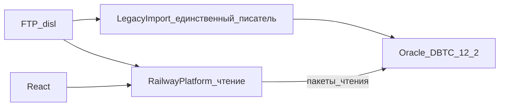

# 01. Обзор системы

Статус: утверждённый проект архитектуры. Журнал решений — [APPROVALS_TEMPLATE.md](APPROVALS_TEMPLATE.md) (2026-11-13). Приложение не создаётся этим документом. Схема Oracle не меняется. Секреты и строки соединения сюда не переносятся.

Источник истины целевой платформы — документы `01`…`20` и [decisions/](decisions/). Опора по фактам старого контура: [08_CROSS_SYSTEM_MATRIX.md](../analysis/08_CROSS_SYSTEM_MATRIX.md), [08_GAPS_AND_UNCERTAINTIES.md](../analysis/08_GAPS_AND_UNCERTAINTIES.md). Ранняя матрица [09-function-gap-matrix.md](../analysis/09-function-gap-matrix.md) для проектирования устарела. Черновик на C# / Blazor в [_archive_csharp/](_archive_csharp/) и [10-target-architecture-migration.md](../analysis/10-target-architecture-migration.md) стеком не является.

Смежные документы: [02_TECHNOLOGY_STACK.md](02_TECHNOLOGY_STACK.md), [03_MODULAR_ARCHITECTURE.md](03_MODULAR_ARCHITECTURE.md), [17_MIGRATION_ROADMAP.md](17_MIGRATION_ROADMAP.md).

## Назначение

Единая корпоративная платформа на Java постепенно закрывает процессы одной железнодорожной компании. Первый контур замены — пять программ одной схемы `DBTC`. Экспедирование, договоры, финансы и обмен с 1С в старых программах как готовые модули не обнаружены. Их правила будут заданы отдельно и в этот документ не дописываются.

Платформа рассчитана на одну компанию и 20–30 одновременных пользователей, с возможностью добавить функции и пользователей без смены формы системы. Микросервисы на старте не вводятся.

## Что заменяется

| Имя в задании | Поставка | Сборка |
| --- | --- | --- |
| НУВ | `WagonApp` и `WagonPlanner` | 2.2.1.25 и 1.2.2.85 |
| УВП | `WagonApp` без планировщика | 2.2.1.26 |
| НУД | `WarehouseApp` | 1.2.0.29 |
| АСУ-ВП | две копии `ApplicationService` | 1.0.3.37 |
| Пользовательские отчёты | `ReportingLib` внутри клиентов | отдельного хоста нет |

АСУОП (`cncClient`, MSSQL `terminal`) в замену не входит. Это соседний контур сообщений, не почасовая дислокация.

## Форма системы

Один процесс `RailwayPlatform`: модульный монолит Spring Boot, один REST API, одна модель прав, React-клиент. Фоновые задачи (наблюдение файла, календарь пропущенных часов) живут в том же процессе, пока измерение на копии не покажет, что приём файла ломает ответ карточки. Очередь сообщений до этого измерения не вводится. См. [ADR-0001](decisions/ADR-0001-java-modular-monolith.md).

Старые клиенты и обе копии службы не выключаются. Конфиги копий не смешиваются.

| Копия | Импорт | Маска RU | Каталог |
| --- | --- | --- | --- |
| Сервис приложение | включён | `disl_operations*.txt` | `///tisservice//disl_vagons_tmp//` |
| Сервис пользователя | выключен | `disl_cis*.txt` | `//Infoservice//` |

Включение импорта на пользовательской копии снимет другой набор файлов. Новый хост эти config не копирует.

## Один писатель

На каждый агрегат один владелец записи. На старте все владельцы — старый контур.

| Агрегат | Владелец записи сейчас | Новый хост |
| --- | --- | --- |
| Срез, `IMPORTFILES`, `STATEREPORTS`, `STATEREPORTRECORDS` | Сервис приложение, `ImportPkg` | читает файл локально, в пакет не пишет |
| Карточка `WAGON`, включая `LOCATION*` | `WagonPackage.SaveWagon` и невидимый `WAGONUPDATEDISL` | читает паспорт, станцию срезом не сверяет |
| Проводка ремонта | УВП, `RepairsPkg.Register` | не вызывает |
| Проводка склада | НУД, `WarehousePkg.Register*` | не вызывает |
| Пробег и детали 2612/2731 | Сервис пользователя | не шлёт и не принимает |
| Ночные витрины | jobs `FILLGIVINGREPORTS`, `UPDATEALLREPAIRDATES`, `FILLKPI`, `AVAILABILITY_VIEW_JOB` | читает результат, не пересчитывает |

Новый процесс при старте проверяет, что флаги записи выключены, и отказывается поднять писатель среза, если в конфигурации указан живой старый импортёр.

## Что остаётся снаружи

| Контур | Почему снаружи | Когда можно обсуждать вход |
| --- | --- | --- |
| АСУОП, MSSQL `terminal` | другая база, терминал сообщений, не срезы | отдельное решение после закрытия Oracle-переноса |
| Задачи 2610/2612/2654/2731 | пишут пробег и детали; идемпотентность не измерена (G8) | после измерения на копии и не параллельно со старым приёмником |
| `WAGONUPDATEDISL` | объект вызывающему пользователю не виден, job включён каждые 15 минут (G4) | после нахождения объекта под учёткой владельца |
| Автономные `SP_ARRIVAL*`, `SP_TRANSFERWAGONPART`, `SP_CONVERTREPAIRSTOTR1`, `SP_WAGONEXCLUDE` | клиенты их не вызывают | после поиска в `ALL_SCHEDULER_JOBS` и телах пакетов |
| `PlatformStateReportsJob`, `ExecuteReportData` | методы бросают `NotImplementedException` | эталона нет, переносить нечего |
| Произвольный SQL конструктора и `.brp` | полный SQL попадает в журнал, `BinaryFormatter` без белого списка типов | канал не повторяется; замена — каталог полей |
| Экспедирование, договоры, финансы, 1С | требований и конфигурации в исследовании нет | отдельные задания после волн чтения |

## Ворота записи

Пока нет тела `ImportPkg` (G1–G3, G25), объекта `WAGONUPDATEDISL` (G4), образца `disl_kz*.txt` и read-only учётки копии, новый код файл только разбирает локально. Проводка ремонта и склада ждёт наблюдения G6. Сообщения 2612/2731 ждут измерения G8.

Критерий обсуждения замены импортёра: на одном файле число строк и ключи нового писателя совпали со старым `ImportPkg` на двух копиях, промышленная база не использовалась. Успех чтения уже лежащего среза этот критерий не заменяет.
