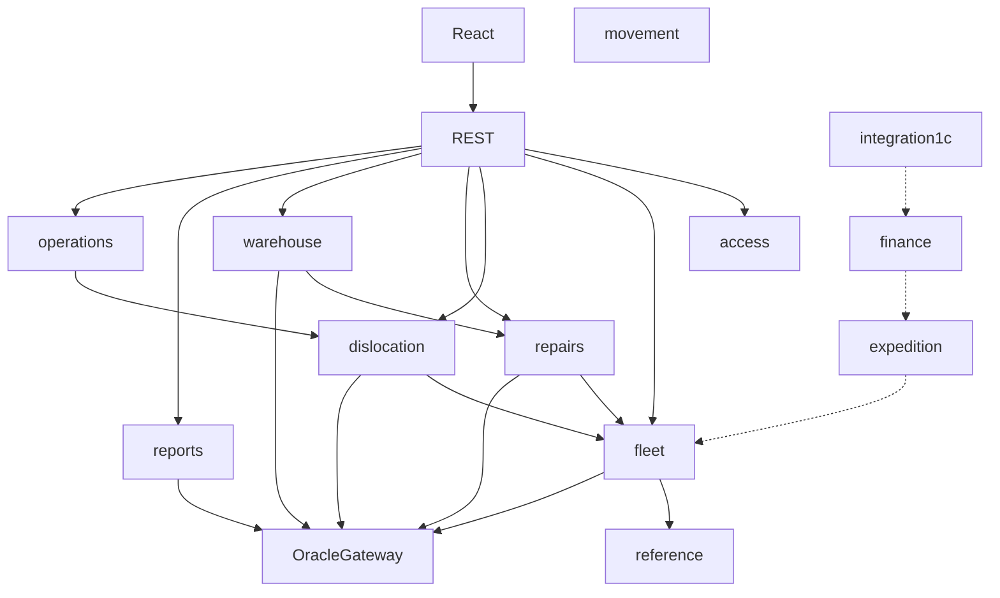

# 03. Модульная архитектура

Граница модуля — агрегаты, которые нельзя писать с двух сторон, и пакет Oracle, который модуль имеет право вызывать. Все модули живут в одном хосте. Проверка границ — Spring Modulith (`ApplicationModules.verify()`), когда появится код. Циклический импорт чужого внутреннего типа — ошибка сборки.

Флаг записи по умолчанию выключен. Класс записи не регистрируется в контексте Spring, пока флаг модуля и разрешение на DML в копии не открыты вместе. На старте владелец записи — старый контур.

## Сводка модулей

| Модуль | Читает | Пишет сейчас | Флаг записи |
| --- | --- | --- | --- |
| `access` | `USERS`, `PERMISSIONS`, `SECURITY` | старый вход клиентов | `Access.Write` выкл |
| `reference` | `STATIONS`, `CUSTOMERS`, `WAGONTYPES`, `REPAIRPLANTS`, `PARTTYPES`, грузы, `OPERATIONS` | старые клиенты | `Reference.Write` выкл |
| `fleet` | `WagonPackage.Get*` | `WagonPackage.SaveWagon` у старого `WagonApp` | `Fleet.Write` выкл |
| `dislocation` | файл локально; позже `GetWagonStateReports` | `ImportPkg` у «Сервис приложение» | `Dislocation.Write` выкл до теста B1 |
| `movement` | после разделения `Get*` и `Save*` в spec | `Giving*` / `WorkListsPkg` у планировщика и импортёра | `Movement.Write` выкл, в проектирование записи не входит |
| `repairs` | `RepairsPkg.Get*` / `Load*`, `RepairBudgetPkg.Get*` | `Save*` / `Register` у УВП, job дат, служба пробега | `Repairs.Write` выкл до B4 |
| `warehouse` | `WarehousePkg.Load*` / `GetDocumentList`, `PartsPackage` | `Register*` у НУД | `Warehouse.Write` выкл до B6 |
| `reports` | процедуры готовых отчётов и каталог полей | ночные jobs витрин | записи отчёта в Oracle нет |
| `operations` | локальный журнал | карантин файла на диске | в `DBTC` не пишет |
| `expedition` | нет источника в исследовании | нет | каркас без правил |
| `finance` | нет источника в исследовании | учёт остаётся в 1С, конфигурация не известна | каркас без проводок |
| `integration-1c` | нет согласованного контракта | нет подключения | каркас журнала обмена без формата |

Пакет `AdminPkg` в `DBTC` не найден. В схеме доступ называется `SECURITY` / `PERMISSIONS`. `AdminPkg` не переносится.

Публичный API модуля — интерфейс в его корневом пакете и DTO. REST-контроллер вызывает этот интерфейс. Имя процедуры Oracle и строка соединения в контроллер не попадают.

Пунктир — будущая связь. Кода вызова нет, пока нет задания на экспедирование, финансы и 1С.

## Пакеты, которые хост имеет право читать

Когда выдана учётка копии:

- `StateReportPackage.GetWagonStateReports`
- `WagonPackage.GetWagonByCode`, `GetWagonList`
- `RepairsPkg.GetRepairList` и `Load*`
- `PartsPackage.GetHistoryState`, `LoadPartHistory`, `SearchParts`
- `WarehousePkg.GetDocumentList`, `LoadWarehouseDetails`

Вызовов `Save*`, `Register*`, `ImportPkg`, `CreateJob*`, `ImportMileage*`, `ImportWagonParts2731` в коде нет, пока для модуля не открыта волна записи.

## Три пула

Конструктор отчётов и импорт среза в старом контуре делят `STATEREPORTRECORDS`. Таймаут службы 60 секунд закрывает сессию.

| Пул | Кто берёт | Чего пул не делает |
| --- | --- | --- |
| `Ui` | карточка, список, ремонт, склад | длинные отчёты и разбор файла |
| `Report` | готовые отчёты и конструктор по белому списку | запись и импорт |
| `Observe` | подсчёт уже записанного среза, когда появится учётка копии | `Save*`, `Register*`, `ImportPkg` |

На волне наблюдения файловый наблюдатель Oracle не открывает. Пул `Observe` появляется вместе с первой сверкой «файл против уже лежащих строк».

## API

Браузер Oracle не открывает и текст запроса не получает.

| Граница | Контракт | Запрещено на старте |
| --- | --- | --- |
| UI → REST | JSON и код права | строка соединения, имя процедуры |
| REST → модуль | команда экрана и DTO | произвольный SQL |
| Модуль → шлюз | операция чтения с именем пакета из белого списка | склейка `SELECT` клиентом |
| Наблюдатель → журнал | локальный файл журнала часа | вызов `ImportPkg` |
| Отчёт → шлюз | поле из каталога и обязательный период | склейка `SELECT` клиентом |

Идемпотентность файла, когда запись откроется: ключ `(имя файла, тип среза)`, как `ImportPkg.IsImportedFile`. Повтор того же ключа не добавляет второй комплект строк. Час — свойство имени и полей файла. Таймер старого сервиса (45 секунд у импортёра, 60 у пользовательской копии) означает только опрос каталога.

Старый Remoting (порты 5502, 5505, 5507 и непрочитанный полный список URI) в новый хост не переносится.

## Выделение модуля позже

Модуль можно вынести в отдельный процесс только вместе с правом записи его агрегата и только после того, как тело пакета прочитано. До этого вынос создаёт второго писателя. Первым кандидатом на вынос, если измерение это потребует, является приём файла дислокации, не карточка вагона: карточка и срез читают одну базу, а писатель среза один.
