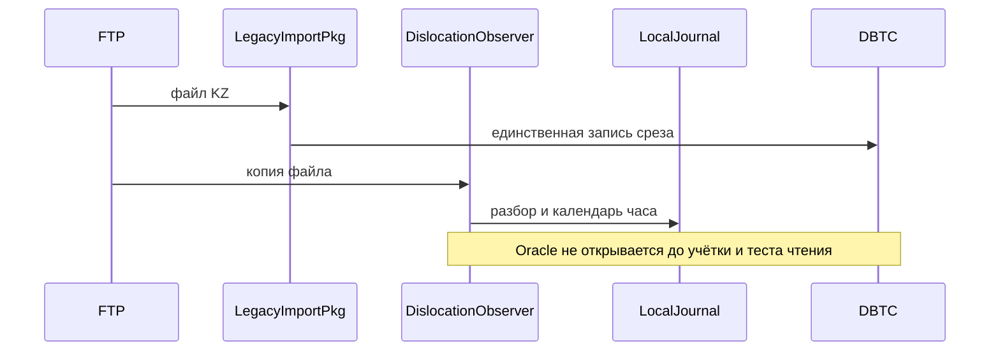

# 07. Интеграция с АСУ-ВП

Источник: [01_ASUVP_IMPORT_PIPELINE.md](../analysis/01_ASUVP_IMPORT_PIPELINE.md), [01_ASUVP_ARCHITECTURE.md](../analysis/01_ASUVP_ARCHITECTURE.md). Тела `ImportPkg` не читались. Образца `disl_kz*.txt` в workspace нет.

## Что делает старая служба

Две копии одного `ApplicationService.exe` 1.0.3.37 различаются только `config.json`. Подменять их нельзя.

Писатель текстового среза — копия «Сервис приложение», класс `RemoteLib.GivingDepartures.ImportStateReportsFtp`.

Порядок приёма KZ: `IsImportedFile` → `SaveImportFile` → `SaveStateReport` → каждая непустая строка → `UpdateStateReport`. Пустой файл удаляется и в Oracle не пишется. Ошибка строки логируется, цикл идёт дальше. Транзакции на весь TXT нет. Таймер опроса эталона — 45 секунд. Час задаёт файл, не таймер.

C# отправляет в `SaveStateReportLineKz` каждую строку файла. Фильтра «вагон не двигался» в C# нет. Сохраняет ли пакет строку без смены станции, не подтверждено (G1).

## Каналы

| Канал | Маска | Тип | Процедура строки |
| --- | --- | --- | --- |
| KZ, полный срез | `disl_kz*.txt` | 0 | `SaveStateReportLineKz` |
| RU | `disl_operations*.txt` | 1 | `SaveStateReportLineRu` |
| TIS RU | `disl_vagons_cis*.txt` | 2 | та же `SaveStateReportLineKz` |
| Третьи стороны | `disl_vagons_all_*.txt` | 16 | та же `SaveStateReportLineKz` |
| Контейнеры | `disl_containers_*.txt` | 3 | `SaveStateReportLineContainer`, первая строка пропускается |
| Excel KZ | `*_disl_kz.xls` | 23 | `UpdateStateReportXml` |

`disl_operations*.txt` — канал RU, 11 полей. Отдельной дельтой KZ он не считается, пока нет образца (M2).

`wagons.txt` (18 334 строки у пользовательской копии) — публикация `GivingDeparture.PublishRegistryStateReports`, не строки среза. Модуль дислокации его не подменяет.

Учётки строк импорта: `asuvp_thread_01`…`asuvp_thread_04`, третьи стороны `_21`, Excel `_32`. Новый хост этими учётными записями не пользуется.

## Строка KZ, которую уже видно в C#

Разделитель — табуляция, 20 или 21 поле. В процедуру уходят: номер вагона, станция дислокации, индекс поезда, дата дислокации, код операции, станция назначения, станция отправления, получатель, отправитель, тип, собственник, НОД, гружёность, рабочее состояние, номер документа, код груза, вес груза, грузоподъёмность, код сообщения, дата операции, контейнеры при 21 поле. Полный список индексов — в [01_ASUVP_IMPORT_PIPELINE.md](../analysis/01_ASUVP_IMPORT_PIPELINE.md). Это контракт вызова, не доказанный состав колонки `STATEREPORTRECORDS`.

## Как это выглядит в новой системе

До теста B1 модуль `dislocation` файл читает и считает, в базу не пишет. Повтор берётся из каталога `quarantine` и только если ключ `(имя, тип)` ещё не зафиксирован. Повтор того же имени в старый `ImportPkg` для починки дыры запрещён: флаг мог встать раньше конца файла, а сам файл уже лежит в `processing` (G2).

Каналы TIS, контейнеров и Excel на первой замене писателя не переключаются. Их оставляет старый импортёр, пока KZ-канал не пройдёт B1.

Сообщения 2610/2612/2731 остаются на «Сервис пользователя». Новый код `ImportMileage*` и `ImportWagonParts2731` не вызывает (G8).

## Что остаётся в Oracle

Пока тело пакета не прочитано, правило записи строки, обновление последнего среза, возможное создание заданий `CreateJob*` и любая правка `WAGON` остаются внутри `ImportPkg` и jobs. Java это правило не восстанавливает по имени процедуры.

Чтение истории для экрана, когда будет учётка: `StateReportPackage.GetWagonStateReports`, интервал суток 00:00:00–23:59:59. Что вернёт курсор на неполном часе, телом не подтверждено.

## Проверка и риски

Совпадение будущего писателя — тест B1: число строк и ключи `IMPORTFILES`, `STATEREPORTS`, `STATEREPORTRECORDS` (имя файла, тип, код вагона, время дислокации, станция, операция). Лишняя строка — провал. Пропуск строки, которую старый пакет сохранил, — провал. Успех чтения уже лежащего среза (A1) замену импортёра не открывает.

Риски: два писателя в один `ImportPkg`; путаница двух config; частичный час без отката; `CreateJob*` после `UpdateStateReport` (G25, не подтверждено). Пока тела нет, новый процесс писателя не поднимает.
