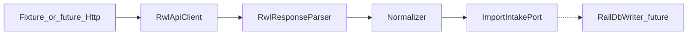

# 26. Java-интеграция RWL (P2, offline)

Статус: **проектирование + offline-код**. Live HTTP к RWL, запись в Oracle и смена REST **запрещены** в P2.

Связано: [ADR-0009](decisions/ADR-0009-raildb-primary-store.md) PROPOSED, [12-rwl-api-intake.md](../analysis/12-rwl-api-intake.md), [13-rwl-kz-field-matrix.md](../analysis/13-rwl-kz-field-matrix.md).

## 1. Поток

- `modules/intake` — порты и DTO (без RWL/HTTP/JDBC).
- `platform-rwl` — клиент/парсер/нормализация/in-memory intake (offline).
- `platform-app` / synthetic R0–R3 — **не зависят** от `platform-rwl` в P2.

## 2. Компоненты

| Компонент | Ответственность |
| --- | --- |
| `RwlApiClient` | собирает запрос; **P2:** только `FixtureRwlApiClient`; live-клиент бросает `LiveRwlDisabledException` |
| `RwlResponseParser` | XML (CONFIRMED structure); JSON — provisional по тем же именам полей |
| `RwlNormalizer` | → `NormalizedDislocationEvent` + `eventKey`/`contentHash` (гипотеза, явно помечена) |
| `ImportIntakePort` | принимает батч; идемпотентность по `intakeKey` |
| `InMemoryImportIntake` | P2 реализация без Oracle |
| `RailDbWriter` | **не реализован** |

## 3. Ошибки и устойчивость

- API plain-text / `<error>` → `IntakeStatus.API_ERROR` (без тела пароля).
- Не-XML/битый XML → `PARSE_ERROR`.
- Событие без identity → reject, остальные продолжают.
- `RwlBackoffPolicy` — экспоненциальная задержка для **будущих** retries (unit-tested; live не вызывается).
- Параллелизм: конфиг `maxConcurrentRequests` (default 1 в offline).
- Логи/маскирование: `UrlRedactor` убирает `password=` / `name=` из URL.

## 4. Идемпотентность

1. `intakeKey` = hash(`requestType|paramsSummary|payloadSha256`) — повтор того же ответа не создаёт второй successful intake.
2. Внутри батча: `eventKey` + `contentHash` (как proto) — unchanged / revised (revised только когда появится writer).

## 5. Что не делается в P2

Live RWL, Oracle, Flyway, изменение DBTC, REST, подключение `platform-rwl` к Boot app.
