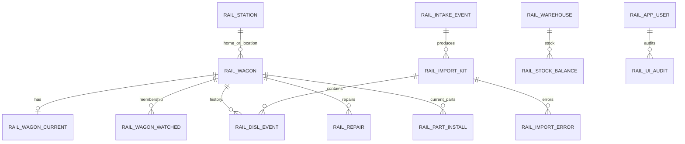

# 27. Логическая ER-модель RAILDB (P3A)

Статус: **черновик**. Поля/UK помечены **PROVISIONAL**, пока P3B не подтвердит словарь DBTC.  
Целевая БД: `RAILDB`, схема `RAIL_APP`. Не применять DDL.

## 1. Обзор доменов

## 2. Подсистемы и таблицы (logical)

| # | Подсистема | Tables (prefix `RAIL_`) | Notes |
| --- | --- | --- | --- |
| 1 | Реестр | `WAGON`, refs `WAGON_TYPE`… | from `WAGON` FULL; code UK PROVISIONAL |
| 2 | Слежение | `WAGON_WATCHED` | source G31 **BLOCKED** |
| 3 | Текущая дислокация | `WAGON_CURRENT` | separate from history |
| 4 | История | `DISL_EVENT` | 12м + bootstrap; **full hours** |
| 5 | Срезы | `IMPORT_KIT`, `HOUR_EXPECTATION`, `KIT_CHANNEL` | kit UK `(file_name, kit_type)` CONFIRMED semantics R0 |
| 6 | Ремонты | `REPAIR`, `REPAIR_TYPE` | TR/KR/DR via type codes |
| 7 | Детали | `PART`, `PART_INSTALL` | from `WAGONPARTS`/`CURRENTPARTS` |
| 8 | Склад | `WAREHOUSE`, `STOCK_BALANCE`, `WH_DOCUMENT`, `WH_DOCUMENT_LINE` | grain P3B |
| 9 | Станции/refs | `STATION`, `CUSTOMER`, `OPERATION`, `CARGO` | REF_FULL |
| 10 | Intake FTP/RWL | `INTAKE_EVENT` | source FTP\|RWL\|FILE |
| 11 | Users/audit | `APP_USER`, `APP_ROLE`, `UI_AUDIT` | new; legacy USERS mapping UNKNOWN |
| 12 | Journals | `IMPORT_ERROR`, `QUARANTINE_FILE`, `MIGRATION_RUN`, `MIGRATION_WATERMARK` | ops |

## 3. Каноническая дислокация (FTP + RWL)

Единая сущность `RAIL_DISL_EVENT` (+ optional extension JSON/`ATTR_*` для RWL-only):

| Canonical field | KZ 20/21 | RWL | Required for hour kit |
| --- | --- | --- | --- |
| `wagon_code` | 0 | `vagon_no` | yes |
| `station_code` | 1 | `current_position_code` | yes |
| `train_index` | 2 | `train_index` | no |
| `dislocation_ts` | 3 PARTIAL | `utc_datetime` | yes (normalize TZ) |
| `operation_code` | 4 | asoup/code PARTIAL | yes |
| `dest_station_code` | 5 | `to_code` PARTIAL | keep nullable |
| `depart_station_code` | 6 | `from_code` PARTIAL | keep nullable |
| `receiver_code` | 7 | KZ_ONLY | **keep** |
| `sender_code` | 8 | KZ_ONLY | **keep** |
| `wagon_type` | 9 | UNKNOWN | keep |
| `wagon_owner` | 10 | KZ_ONLY | keep |
| `nod_code` | 11 | KZ_ONLY | keep |
| `weight_state` | 12 | `loaded` PARTIAL | keep |
| `work_state` | 13 | KZ_ONLY | keep |
| `doc_number` | 14 | KZ_ONLY | keep |
| `cargo_code` | 15 | `etsng_code` PARTIAL | keep |
| `cargo_weight` | 16 | `weight` PARTIAL | keep |
| `capacity` | 17 | KZ_ONLY | keep |
| `message_code` | 18 | KZ_ONLY | keep |
| `operation_ts` | 19 | often = utc | keep |
| `containers` | 20 | PARTIAL | keep |
| `source_system` | FTP/RWL | | yes |
| `kit_id` | FTP kit | nullable for RWL point-in-time | |
| `event_key` / `content_hash` | derived | RWL hypothesis | idempotency |

RWL **не** замена FTP для ~18k hour kit (**UNKNOWN** capability) — [13-rwl-kz-field-matrix.md](../analysis/13-rwl-kz-field-matrix.md).

## 4. Ключи и индексы (PROVISIONAL)

| Table | PK | Unique | Indexes |
| --- | --- | --- | --- |
| `RAIL_WAGON` | `wagon_id` | `wagon_code` | code |
| `RAIL_WAGON_WATCHED` | (`wagon_id`) or surrogate | `wagon_id` | |
| `RAIL_WAGON_CURRENT` | `wagon_id` | — | station, updated_at |
| `RAIL_IMPORT_KIT` | `kit_id` | `(file_name, kit_type)` | `(channel, hour_slot)` |
| `RAIL_DISL_EVENT` | `event_id` | **PROVISIONAL** `(kit_id, wagon_id)` for full-hour lines; alt `(event_key)` for RWL | `(wagon_id, dislocation_ts)`, `(dislocation_ts)` local on partition |
| `RAIL_INTAKE_EVENT` | `intake_id` | `idempotency_key` | |
| `RAIL_REPAIR` | `repair_id` | PROVISIONAL legacy id map | `(wagon_id, begin_ts)` |

Natural key `STATEREPORTRECORDS` в DBTC **отсутствует** → UK в RAILDB утверждать только после P3B/B1.

## 5. Партиционирование истории

- `RAIL_DISL_EVENT`: **RANGE** по `dislocation_ts` (месяц), Oracle 12.2 compatible.
- Align with filter axis preference: default **`GETTING_DATE`-equivalent** stored as `dislocation_ts` until P3B chooses otherwise.
- Keep full-hour rows (unchanged wagons included) when source is FTP kit.

## 6. Историческое состояние на дату

1. `RAIL_WAGON_CURRENT` — сейчас.  
2. As-of query: last `RAIL_DISL_EVENT` per wagon with `dislocation_ts <= :asOf` (partition prune).  
3. Bootstrap at cutoff seeds continuity for 12м window.

## 7. Draft DDL

Только каркас подтверждённых объектов: [sql/raildb/V0__draft_confirmed_core.sql](sql/raildb/V0__draft_confirmed_core.sql). **Не выполнять.**
