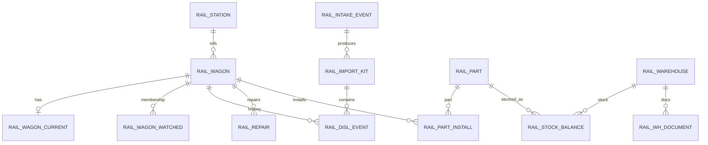

# 27. Логическая ER-модель RAILDB (P3C-1)

Статус: уточнено после P3C-1 прогона `20261116_062146`.  
Целевая БД: `RAILDB` / `RAIL_APP`. **Не применять DDL.**  
Evidence: [36](36_P3B_PARTIAL_DICTIONARY_FINDINGS.md), [37](37_P3C0_SEMANTICS_RESEARCH.md), [39](39_P3C1_SEMANTICS_FINDINGS.md).

## 1. Обзор

## 2. Лента: PK, дубликаты, kit

| Concept | Decision | Evidence |
| --- | --- | --- |
| Technical PK | `RAIL_DISL_EVENT.event_id` (always) | P3B no PK on tape |
| Natural UK from DBTC | **none trusted** | NK1 still **BLOCKED** (no hour dup probe) |
| Duplicates | **retain all** source rows | P3C-0 policy unchanged |
| Provenance / idempotency | `provenance_key=report:wagon:ordinal` + `content_hash` | batch replay safe |
| Kit link | `kit_id` nullable; always store legacy report/file ids | KIT_FK: 701/701 OK in 7d sample |
| Time axis | `getting_ts` partition/migrate; `location_ts` attr | DT1 **BLOCKED**; 12м axis unchanged |
| Bootstrap | last event per wagon `getting_ts <= cutoff` | unchanged |

## 3. Ключи

| Table | PK | Unique / notes |
| --- | --- | --- |
| `RAIL_WAGON` | `wagon_id` | `wagon_code` ← DBTC UK |
| `RAIL_WAGON_WATCHED` | `wagon_id` | source G31 still OPEN |
| `RAIL_WAGON_CURRENT` | `wagon_id` | |
| `RAIL_IMPORT_KIT` | `kit_id` | `(file_name, kit_type)`; `legacy_importfiles_id`; `link_status` |
| `RAIL_DISL_EVENT` | `event_id` (+ partition) | **no** UK (kit,wagon); index `(wagon_id, getting_ts)` |
| `RAIL_REPAIR` | `repair_id` | `legacy_repair_id`; `is_open` **from CURRENT pointer** |
| `RAIL_PART` | `part_id` | instance-level (← `WAGONPARTS`) |
| `RAIL_STOCK_BALANCE` | surrogate | UK `(warehouse_id, object_id, object_state)`; `object_type` observed `0` |
| `RAIL_STATION` | `station_id` | code |

## 4. Ремонты (RP1 CONFIRMED)

- Open: **все** `WAGON.CURRENTREPAIR_ID` → `is_open='Y'` (возраст begin не режет; есть CURRENT старше 12м).
- Не использовать `ENDINGDATE IS NULL` как единственный критерий (24 CURRENT с ENDINGDATE set).
- Closed 12м: `ENDINGDATE` в окне (~25094 на ориентир cutover 2026-11-16).
- Orphan `ENDINGDATE IS NULL` вне CURRENT в окне begin≥2025-10-12: **0**.

## 5. Склад (WH1 CONFIRMED)

- Stock FULL: `WAREHOUSEDETAILS` (+ `WAREHOUSES`) на cutover.
- `OBJECT_ID` → `WAGONPARTS.ID` (8877/8880), не `PARTTYPES`.
- `OBJECT_TYPE`: только `0` в текущем снимке — не финализировать enum шире.
- `OBJECT_STATE`: ids 1/2/21/NULL; имена `BUYINGTYPES` недоступны RO (ORA-00942).
- Docs 12м by `DELIVERYDATE` — отдельно.

## 6. Слежение (G31 OPEN)

`RAIL_WAGON_WATCHED` пуст до DBA SPEC / approved snapshot. Не путать с реестром `WAGON` / document `WAGONSTATEREPORTS`.

## 7. Draft DDL

[sql/raildb/V0__draft_confirmed_core.sql](sql/raildb/V0__draft_confirmed_core.sql) — draft only; **не выполнять**.
