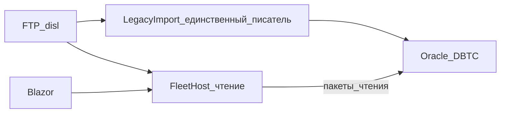

# Архитектура платформы управления вагонным парком

> Superseded by the numbered Java set in `docs/architecture/01`…`20`. Факты об Oracle, модулях и волнах остаются в силе. Стек C# / .NET 10 / Blazor этим набором не выбран.


Статус: проект на утверждение. Приложение не создаётся. Схема Oracle не меняется. Секреты, пароли и строки соединения в этот документ не переносятся.

Опора: [08_CROSS_SYSTEM_MATRIX.md](../../analysis/08_CROSS_SYSTEM_MATRIX.md), [08_GAPS_AND_UNCERTAINTIES.md](../../analysis/08_GAPS_AND_UNCERTAINTIES.md), [08_EQUIVALENCE_TESTS.md](../../analysis/08_EQUIVALENCE_TESTS.md), [02_ORACLE_PERFORMANCE.md](../../analysis/02_ORACLE_PERFORMANCE.md), [03_BUSINESS_LOGIC.md](../../analysis/03_BUSINESS_LOGIC.md). Ранняя матрица [09-function-gap-matrix.md](../../analysis/09-function-gap-matrix.md) для проектирования устарела: виды ремонта 0…8 и документы склада 0…6 разобраны на этапах 5–6.

Смежные документы: [MODULES.md](MODULES.md), [DATA_STRATEGY.md](DATA_STRATEGY.md), [MIGRATION_ROADMAP.md](MIGRATION_ROADMAP.md), [TEST_STRATEGY.md](TEST_STRATEGY.md).

## 1. Назначение

Единая платформа постепенно заменяет пять контуров одной схемы `DBTC`:

| Имя в задании | Поставка | Сборка |
| --- | --- | --- |
| НУВ | `WagonApp` и `WagonPlanner` | 2.2.1.25 и 1.2.2.85 |
| УВП | `WagonApp` без планировщика | 2.2.1.26 |
| НУД | `WarehouseApp` | 1.2.0.29 |
| АСУВП | две копии `ApplicationService` | 1.0.3.37 |
| Пользовательские отчёты | `ReportingLib` внутри клиентов | отдельного хоста нет |

АСУОП (`cncClient`, MSSQL `terminal`) в эту замену не входит. Это соседний контур сообщений, не почасовая дислокация.

## 2. Форма системы

Первый этап — один модульный монолит.

| Слой | Кандидат | Когда считается выбранным |
| --- | --- | --- |
| Язык и runtime | C#, .NET 10 | после сборки пустого хоста на машине разработки |
| HTTP и UI | ASP.NET Core, Blazor Server | вместе с первым читающим экраном |
| Хранилище | существующая Oracle `DBTC` 12.2.0.1.0 | на всём переносе, пока старые EXE живы |
| Фон | `IHostedService` в том же процессе | с наблюдателя файлов |

Микросервисы на первом этапе не вводятся. НУВ, УВП, НУД и отчёты уже сидят на одном `ApplicationService` и одной схеме. Запись среза, проводка ремонта и проводка склада обязаны иметь одного писателя. Тела `ImportPkg`, `RepairsPkg.Register` и `WarehousePkg.Register*` не прочитаны, поэтому резать контур по сети нельзя: второй процесс с правом DML становится вторым писателем.

Единственная допустимая причина второго процесса — несовместимость драйвера Oracle с парой «.NET 10 + Oracle 12.2.0.1». Проверка делается до первого подключения к копии. Если драйвер .NET 10 не открывает 12.2, шлюз Oracle выносится в соседний процесс на поддерживаемой связке. Доменные модули при этом остаются в одном хосте.

Blazor Server выбран потому, что строка соединения и SQL остаются на сервере. У Razor-экранов нет файла Designer Visual Studio. Если позже появится окно WinForms, у него будет файл Designer.

## 3. Процесс и пулы

Один хост `FleetHost`: сайт IIS или служба Windows, один каталог публикации. Внутри него:

- Blazor Server для экранов;
- слой приложения, который UI вызывает напрямую, без отдельного HTTP между ними;
- фоновые службы: наблюдатель файлов, контроль пропущенных часов, сигналы карантина;
- шлюз Oracle.

Три пула соединений в одном процессе. Это ответ на уже видимый конфликт: конструктор отчётов и импорт среза делят `STATEREPORTRECORDS`, таймаут службы 60 секунд закрывает сессию.

| Пул | Кто берёт | Чего пул не делает |
| --- | --- | --- |
| `Ui` | карточка, список, ремонт, склад | длинные отчёты и разбор файла |
| `Report` | готовые отчёты и конструктор по белому списку | запись и импорт |
| `Observe` | подсчёт уже записанного среза, когда появится учётка копии | `Save*`, `Register*`, `ImportPkg` |

На волне наблюдения файловый наблюдатель Oracle не открывает. Пул `Observe` появляется вместе с первой сверкой «файл против уже лежащих строк».

## 4. Контур

```text
FTP disl_*  →  «Сервис приложение»  →  ImportPkg  →  DBTC
             →  FleetHost-наблюдатель читает копию файла и в БД не пишет

WagonApp / WagonPlanner / WarehouseApp  →  Remoting «Сервис пользователя»
FleetHost Blazor  →  пакеты чтения DBTC (после выдачи учётки копии)

Сообщения 2610/2612/2731  →  остаются на «Сервис пользователя»
cncClient  →  MSSQL terminal, в этот хост не входит
```



Старые клиенты и обе копии службы не выключаются. Конфиги копий не смешиваются.

| Копия | Импорт | Маска RU | Каталог |
| --- | --- | --- | --- |
| Сервис приложение | включён | `disl_operations*.txt` | `///tisservice//disl_vagons_tmp//` |
| Сервис пользователя | выключен | `disl_cis*.txt` | `//Infoservice//` |

Включение импорта на пользовательской копии снимет другой набор файлов. Новый хост эти config не копирует.

## 5. API

Внешний контракт экрана — методы слоя приложения. Браузер Oracle не открывает и текст запроса не получает.

Внутренние границы:

| Граница | Контракт | Запрещено на старте |
| --- | --- | --- |
| UI → приложение | команда экрана и DTO | строка соединения, имя процедуры |
| Приложение → шлюз | операция чтения с именем пакета из белого списка | произвольный SQL |
| Наблюдатель → журнал | локальный файл журнала часа | вызов `ImportPkg` |
| Отчёт → шлюз | поле из каталога и обязательный период | склейка `SELECT` клиентом |

`OracleGateway` — единственное место, где живёт строка соединения.

- Адаптер чтения вызывает существующую процедуру и кладёт курсор в DTO.
- Адаптер записи — отдельные классы. В DI они не регистрируются, пока флаг модуля выключен.
- Отчётный адаптер берёт пул `Report`, имеет свой таймаут и требует предикат даты на корнях `STATEREPORTRECORDS` и `WAGONDOWNTIME`.

Учётка нового приложения отдельная от `asuvp_thread_01`…`asuvp_thread_04`, `_21` и `_32`. На волнах чтения у неё `SELECT` и `EXECUTE` только на пакеты чтения. Промышленные строки из config старых EXE не используются.

Пакеты, которые хост имеет право читать, когда учётка выдана:

- `StateReportPackage.GetWagonStateReports`
- `WagonPackage.GetWagonByCode`, `GetWagonList`
- `RepairsPkg.GetRepairList` и `Load*`
- `PartsPackage.GetHistoryState`, `LoadPartHistory`, `SearchParts`
- `WarehousePkg.GetDocumentList`, `LoadWarehouseDetails`

Вызовов `Save*`, `Register*`, `ImportPkg`, `CreateJob*`, `ImportMileage*`, `ImportWagonParts2731` в коде нет, пока для модуля не открыта волна записи. Открытие волны — отдельное разрешение на DML в копии и пройденный тест группы B. См. [MIGRATION_ROADMAP.md](MIGRATION_ROADMAP.md).

Идемпотентность файла, когда запись откроется: ключ `(имя файла, тип среза)`, как `ImportPkg.IsImportedFile`. Повтор того же ключа не добавляет второй комплект строк. Час — свойство имени и полей файла. Таймер старого сервиса (45 секунд у импортёра, 60 у пользовательской копии) означает только опрос каталога.

Старый Remoting (порты 5502, 5505, 5507 и непрочитанный полный список URI) в новый хост не переносится.

## 6. Граница со старым контуром

Один владелец записи на агрегат. На старте все владельцы — старый контур.

| Агрегат | Владелец записи сейчас | Новый хост |
| --- | --- | --- |
| Срез, `IMPORTFILES`, `STATEREPORTS`, `STATEREPORTRECORDS` | Сервис приложение, `ImportPkg` | читает файл локально, в пакет не пишет |
| Карточка `WAGON`, включая `LOCATION*` | `WagonPackage.SaveWagon` и невидимый `WAGONUPDATEDISL` | читает паспорт, станцию срезом не сверяет |
| Проводка ремонта | УВП, `RepairsPkg.Register` | не вызывает |
| Проводка склада | НУД, `WarehousePkg.Register*` | не вызывает |
| Пробег и детали 2612/2731 | Сервис пользователя | не шлёт и не принимает |
| Ночные витрины | jobs `FILLGIVINGREPORTS`, `UPDATEALLREPAIRDATES`, `FILLKPI`, `AVAILABILITY_VIEW_JOB` | читает результат, не пересчитывает |

Новый процесс при старте проверяет, что флаги записи выключены, и отказывается поднять писатель среза, если в конфигурации указан живой старый импортёр.

Два писателя в один `ImportPkg` запрещены. Второй вызов с тем же именем либо пропустит файл, либо допишет строки, если флаг ещё не стоит, либо создаст задания `CreateJob*`.

Пользователь переключается по экрану. База одна, писатель один, обратная миграция строк не делается: роль возвращается на старый EXE. Порядок волн — в [MIGRATION_ROADMAP.md](MIGRATION_ROADMAP.md).

## 7. Что остаётся снаружи

| Контур | Почему снаружи | Когда можно обсуждать вход |
| --- | --- | --- |
| АСУОП, MSSQL `terminal`, SOAP CNC | другая база, терминал сообщений, не срезы | отдельное решение после закрытия Oracle-переноса |
| Задачи 2610/2612/2654/2731 | пишут пробег и детали; идемпотентность не измерена (G8) | после измерения на копии и не параллельно со старым приёмником |
| `WAGONUPDATEDISL` | объект вызывающему пользователю не виден, job включён каждые 15 минут (G4) | после нахождения объекта под учёткой владельца |
| Автономные `SP_ARRIVAL*`, `SP_TRANSFERWAGONPART`, `SP_CONVERTREPAIRSTOTR1`, `SP_WAGONEXCLUDE` | клиенты их не вызывают | после поиска в `ALL_SCHEDULER_JOBS` и телах пакетов |
| `PlatformStateReportsJob`, `ExecuteReportData` | методы бросают `NotImplementedException` | эталона нет, переносить нечего |
| Произвольный SQL конструктора и `.brp` | полный SQL попадает в журнал, `BinaryFormatter` без белого списка типов | канал не повторяется; замена — каталог полей |

## 8. Развёртывание и защита

Один каталог публикации. Секреты вне репозитория и вне документов архитектуры.

Резервная копия данных на всём переносе — существующий RMAN схемы `DBTC`. Своей базы у хоста нет, отдельная схема backup не проектируется. Принятые файлы наблюдателя хранятся на диске не меньше 30 суток, чтобы повтор не зависел от FTP.

Журнал нового хоста пишет действие пользователя, имя файла и код ошибки. Текст запроса и значения фильтров в журнал не пишутся. Проверка права стоит на сервере до вызова пакета: старый `GetData` флаг операции не читает, и этот обход не повторяется.

Нагрузка гоняется на копии. Полный проход 1,2 млрд строк `STATEREPORTRECORDS` и конструктор без периода в испытание не входят. Пороги — в [TEST_STRATEGY.md](TEST_STRATEGY.md).

## 9. Ворота, без которых запись не начинается

Пока нет тела `ImportPkg` (пробелы G1–G3, G25), объекта `WAGONUPDATEDISL` (G4), образца `disl_kz*.txt` и read-only учётки копии, новый код файл только разбирает локально. Проводка ремонта и склада ждёт наблюдения G6. Сообщения 2612/2731 ждут измерения G8.

Критерий, после которого можно обсуждать замену импортёра: на одном файле число строк и ключи нового писателя совпали со старым `ImportPkg` на двух копиях, промышленная база не использовалась. Успех чтения уже лежащего среза этот критерий не заменяет.
